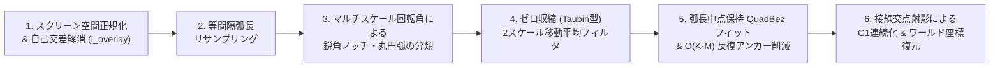

# is2d — 描画・幾何・補間アルゴリズムの数学的根拠

本ドキュメントは、is2d において Adobe Animate（旧 Macromedia Flash）のマージ描画・ベクターブラシ・輪郭粘土変形・クラシックトゥイーン補間を実現している幾何アルゴリズムと数学的根拠をまとめた技術仕様書です。
（※ 操作ガイドおよびアーキテクチャ概要は [`DOCUMENT.md`](./DOCUMENT.md) を参照してください。）

---

## 1. ベクター図形の表現と基本幾何演算（`Contour` / `FillShape`）

### 1.1 2次ベジェ曲線（`QuadBez`）による閉輪郭表現
Adobe Animate と同じく、すべての図形輪郭（[`Contour`](./src/vector_engine.rs)）を3次ベジェではなく **2次ベジェ曲線（Quadratic Bézier Curve）** の閉じたチェインとして表現します。2次ベジェ曲線は制御点 $P_1$ が1つだけであり、「曲線の途中をつまんで引っ張る」操作に対して制御点が一意に決まるという幾何学的な利点があります。

各セグメント $i \in \{0, \dots, N-1\}$ は始点 $P_{0,i}$、制御点 $P_{1,i}$、終点 $P_{2,i}$ を持ち、パラメータ $t \in [0, 1]$ に対して次式で定義されます。

$$B_i(t) = (1-t)^2 P_{0,i} + 2(1-t)t P_{1,i} + t^2 P_{2,i}$$

1階微分（接線ベクトル）は次式となります。

$$B_i'(t) = 2(1-t)(P_{1,i} - P_{0,i}) + 2t(P_{2,i} - P_{1,i})$$

閉ループの $C^0$ 連続条件として、隣接セグメント間で常に $P_{2,i} = P_{0,(i+1)\bmod N}$ を保証します（[`Contour::enforce_continuity`](./src/vector_engine.rs)、[`Contour::from_segments_oriented`](./src/vector_engine.rs)）。

### 1.2 De Casteljau 分割による形状不変アンカー追加と削除
- **アンカー追加（[`Contour::insert_anchor_at`](./src/vector_engine.rs)）**：
  セグメント上の指定パラメータ $t \in [0.08, 0.92]$ において De Casteljau のアルゴリズムを適用し、元の曲線形状を一切変えずに2つの2次ベジェ曲線 $[0, t]$ と $[t, 1]$ に厳密分割します。
  $$Q_0 = (1-t)P_0 + t P_1, \quad Q_1 = (1-t)P_1 + t P_2, \quad R = (1-t)Q_0 + t Q_1 = B(t)$$
  分割後の左セグメントは $(P_0, Q_0, R)$、右セグメントは $(R, Q_1, P_2)$ となり、合成曲線は元の $B(t)$ と数学的に完全一致します。
- **アンカー削除（[`Contour::delete_anchor_at`](./src/vector_engine.rs)）**：
  指定アンカー $P_{0,i}$ を削除し、前セグメントの始点 $P_{0,i-1}$ と当該セグメントの終点 $P_{2,i}$ を中点制御点 $P_1 = \frac{1}{2}(P_{0,i-1} + P_{2,i})$ を持つ直線2次ベジェで結びます。

### 1.3 符号付き面積とワインディング規約
[`Contour::signed_area`](./src/vector_engine.rs) では各セグメントを8等分評価した頂点列 $(V_0, V_1, \dots, V_{M-1})$ に対し、**Shoelace（測量士）の公式** を直接適用して符号付き面積 $A$ を算出します。

$$A = \frac{1}{2} \sum_{k=0}^{M-1} (V_{k,x} V_{k+1,y} - V_{k+1,x} V_{k,y}) \quad (V_M = V_0)$$

- **外周輪郭（`exterior`）**：$A > 0$（画面座標系で時計回り）
- **内周穴輪郭（`holes`）**：$A < 0$（画面座標系で反時計回り）

---

## 2. アルゴリズム 1：丸ブラシ軌跡からの厳密なオフセット包絡線生成

[`generate_brush_outline_at_zoom`](./src/vector_stroke.rs) は、マウスドラッグで得られた中心点列（スパイン） $(C_0, C_1, \dots, C_{n-1})$ とブラシ半径 $r$ から、**描いた軌跡の中心線を一切改変せずに** 半径 $r$ の円盤が掃引する閉包絡線（Envelope）を生成します。

1. **スクリーン空間基準の最小ステップ間引き**：
   現在のズーム倍率を $z \in [0.15, 16.0]$ としたとき、スクリーン上のブラシ半径 $r_{\text{screen}} = r \cdot z$ に比例する最小サンプリング間隔
   $$d_{\min} = \frac{\operatorname{clamp}(0.15 \, r_{\text{screen}},\; 0.2,\; 0.8)}{z}$$
   未満の重複入力点のみを除去します。
2. **単位接線ベクトルと左法線ベクトル**：
   各線分区間 $i \in \{0, \dots, n-2\}$ について単位接線 $T_i$ と左単位法線 $N_i$ を求めます。
   $$T_i = \frac{C_{i+1} - C_i}{\|C_{i+1} - C_i\|}, \quad N_i = (-T_{i,y},\; T_{i,x})$$
3. **屈曲部の Round Join（円弧補間）と緩やかな曲率部の平均法線オフセット**：
   各中間頂点 $C_i$ における局所折れ角 $\theta_i = \operatorname{atan2}(T_{i-1} \times T_i,\; T_{i-1} \cdot T_i)$ と2ステップ窓のマクロ折れ角 $\theta_{\text{macro},i}$ を評価します。
   - $|\theta_i| > 0.08\text{ rad}$ かつ $|\theta_{\text{macro},i}| > 0.25\text{ rad}$ で同符号の明確な屈曲点では、ターンの**外側（凸側）** にマイター突出（角のトゲ）が生じないよう、角度 $|\theta_i|$ をステップ数 $S = \operatorname{clamp}(\lceil |\theta_i| / (\pi/12) \rceil, 1, 16)$ で分割した半径 $r$ の円弧点列を挿入します。
     $$P_{\text{arc}}(a) = C_i + r \left( \mp N_{i-1} \cos a + T_{i-1} \sin a \right) \quad (0 \le a \le |\theta_i|)$$
   - それ以外の緩やかな区間では、前後弦方向の平均単位ベクトルから求めた滑らかな法線 $N_{\text{smooth},i}$ を用いて左右オフセット点 $C_i \pm r N_{\text{smooth},i}$ を配置します。
4. **始点・終点の 180° Round Cap（半円キャップ）**：
   終点 $C_{n-1}$ および始点 $C_0$ の周囲を16分割の半円弧（$\angle \in [0, \pi]$）で閉じることで、ストローク中と寸分違わない丸ブラシ輪郭ポリゴンを構築します。

---

## 3. アルゴリズム 2：軌道・形を変えない Adobe Animate 方式 2次ベジェ輪郭構築

[`build_smoothed_stroke_shapes_at_zoom`](./src/vector_stroke.rs) および [`smooth_ring_to_quad_contour`](./src/vector_stroke.rs) は、生のブラシ輪郭ポリゴンから「手描きの軌道・線幅・小さな円の形・丸キャップ」をそのまま保ちつつ、ピクセルジャギーの除去と不要な中間アンカーの削減のみを行う6段階のパイプラインです。

### 3.1 スクリーン空間正規化による完全なズーム不変性
100% 表示時と 400%〜1600% 拡大描画時でスムージングの強さやアンカー削減挙動が変わってしまう問題を防ぐため、入力されたワールド座標の輪郭点列 $P_{\text{world}}$ を最初に現在のズーム倍率 $z$ でスクリーン座標（px 単位）へ変換します。

$$P_{\text{screen}} = z \cdot P_{\text{world}}$$

以降の自己交差解消（`simplify_shape`）・ブラシ半径推定・リサンプリング（[`resample_closed_ring_uniform`](./src/vector_stroke.rs)）・平滑化・ベジェ近似のすべてを **スクリーン空間（px 基準）** で実行し、完成した [`Contour`](./src/vector_engine.rs) に最後だけ逆スケール変換 $z^{-1}$ を適用します。これにより、どのズーム倍率で描いても画面上の見た目に完全一致したズーム不変（Bit-for-Bit Zoom Invariant）な結果が得られます。

### 3.2 Steiner の管状近傍公式によるブラシ半径推定と小円保護スケーリング
自己交差解消後のポリゴンリング群（外周＋内周穴）の正味面積 $A_{\text{net}}$ と総周長 $L$ から、[`estimate_brush_radius_from_shape_rings`](./src/vector_stroke.rs) にてスクリーン空間での実効ブラシ半径 $r_{\text{est}}$ を推定します。

- 長さ $\ell$、半径 $r$ のストロークの面積は $A \approx 2r\ell + \pi r^2$、周長は $L \approx 2\ell + 2\pi r$ であるため、**Steiner の管状近傍公式** より比 $A / L$ はブラシ半径 $r$ に比例します（$r \approx 1.05 \, A_{\text{net}} / L$）。
- 一方、スタンプや小さな円塊のように**等周商（Circularity）**
  $$C = \frac{4\pi A_{\text{net}}}{L^2} > 0.78$$
  が高い単一リングでは、円の面積・周長比 $A / L = r / 2$ に従い $r_{\text{est}} = 2 A_{\text{net}} / L$ として正確に半径を復元します。

さらに、各リング自身の周長半径 $R_{\text{ring}} = L_{\text{ring}} / 2\pi$ からスケール係数 `r_scale` と小ループ保護係数 `small_ring_factor` を算出します（[`smooth_ring_to_quad_contour`](./src/vector_stroke.rs)）。

$$r_{\text{scale}} = \min\!\left(\operatorname{clamp}\!\left(\frac{r_{\text{est}}}{8.0},\; 0.05,\; 1.5\right),\; \operatorname{clamp}\!\left(\frac{R_{\text{ring}}}{20.0},\; 0.05,\; 1.5\right)\right), \quad f_{\text{small}} = \operatorname{clamp}\!\left(\frac{R_{\text{ring}}}{42.0},\; 0.25,\; 1.0\right)$$

これにより、細ペンや小さな円・小さな内周穴では平滑化窓や近似許容誤差が自動的に最大 $1/4$ まで縮小され、小さな円が勝手に変形されたり潰れたりすることを防ぎます。

### 3.3 マルチスケール回転角による特徴点（鋭角ノッチ・丸キャップ・丸コーナー）の分類とロック頂点抽出
等間隔弧長ステップ $\Delta s$ でリサンプリングされた頂点列 $D_0, \dots, D_{m-1}$ に対し、[`classify_and_align_ring_features`](./src/vector_stroke.rs) では4つの空間スケール窓（$1$, $w_{\text{short}} \approx 4 r_{\text{scale}} / \Delta s$, $w_{\text{local}} \approx 6 r_{\text{scale}} / \Delta s$, $w_{\text{macro}} \approx 18 r_{\text{scale}} / \Delta s$）で符号付き回転角を計測します。

$$\theta_w(i) = \operatorname{atan2}\!\left(\hat{d}_{\text{in}}(i, w) \times \hat{d}_{\text{out}}(i, w),\; \hat{d}_{\text{in}}(i, w) \cdot \hat{d}_{\text{out}}(i, w)\right)$$

1. **鋭角コーナー・自己交差V字ノッチ（`is_sharp_corner`）の検出（[`detect_sharp_corners`](./src/vector_stroke.rs)）**：
   丸ブラシの外周（`is_exterior == true`）における凸方向の回転（$\theta_{w_{\text{short}}} \cdot \operatorname{sign}(A) > 0$）は必ず半径 $r$ の円弧であるため1点の鋭角から除外し、自己交差くびれ（凹方向のV字ノッチ）や内周穴の角のみを局所ピーク判定で1点ロックします。
2. **丸キャップ・局所丸コーナー（`is_round_arc`）の検出と検証（[`detect_round_arcs`](./src/vector_stroke.rs), [`filter_protected_round_features`](./src/vector_stroke.rs)）**：
   3スケール（$\theta_{\text{short}}, \theta_{\text{local}}, \theta_{\text{macro}}$）がすべて同符号かつ閾値を超える連続区間を丸円弧候補として抽出し、区間全体のネット回転角 $\Theta_{\text{net}} \ge 1.85\text{ rad}$ のものを **180° 丸キャップ**、前後のフランジ（側面）曲率が低く局所に集中しているものを **丸コーナー** として保護します。
   ただし、鋭角を持たず全周の $60\%$ 以上が `is_round_arc` となる図形は「手描きの円・楕円ループ」であるため、一部だけをキャップと誤認して歪めないよう `is_round_arc` を全解除して全周を均一に扱います。
3. **保護ランの出入口・中点ロック（[`select_locked_feature_anchors`](./src/vector_stroke.rs)）**：
   平滑化後の輪郭上で、鋭角ピークは1点ロックし、丸コーナーおよび丸キャップの連続ラン（`is_high_curv && !is_sharp_corner`）は出入口アンカー（`i_start`, `i_end`）および $\Theta_{\text{net}} > 1.75\text{ rad}$ の丸キャップ中点をロックします。

### 3.4 ゼロ収縮（Zero-Shrinkage / Taubin 型）2スケール移動平均フィルタ
通常の移動平均（ラプラシアン平滑化）を閉曲線に反復適用すると、曲率ベクトル方向に頂点が内側へ移動し、円や角が痩せて形が変わってしまいます。これを防ぐため、[`apply_zero_shrinkage_smoothing`](./src/vector_stroke.rs) では **狭窓変位から広窓変位（大局的な曲率ドリフト）を差し引く2スケール・バンドパスフィルタ** を採用しています。

1. **狭窓平均変位（高周波ジャギー＋大局曲率）**：
   高曲率特徴点からの距離 $d_{\text{hc}}(i)$ に応じて窓幅 $w = \min(d_{\text{hc}}(i), 3)$ を定め、近傍平均への変位ベクトル $\Delta_{\text{narrow}}(i)$ を求めます。
   $$\Delta_{\text{narrow}}(i) = \frac{1}{2w} \sum_{k=1}^{w} \left(D_{i-k} + D_{i+k}\right) - D_i$$
2. **広窓平均変位（大局曲率ドリフト成分の推定）と差し引き**：
   より広い窓 $w_{\text{wide}} \le 6$ で $\Delta_{\text{narrow}}$ の移動平均 $\Delta_{\text{wide}}(i)$ を計算し、次式で高周波のピクセル階段ノイズ成分のみを抽出します。
   $$\Delta_{\text{eff}}(i) = \left(\Delta_{\text{narrow}}(i) - 1.02 \, \Delta_{\text{wide}}(i)\right) \cdot \operatorname{fade}(i)$$
3. **サブピクセル変位クランプ（軌道不変保証）**：
   4パスの反復中、元のリサンプリング頂点 $D_i^{(0)}$ からの累積移動距離を最大
   $$\left\|D_i - D_i^{(0)}\right\| \le 0.45 \cdot r_{\text{scale}} \cdot f_{\text{small}} \quad (\text{標準ブラシで最大 } 0.45\text{ px、小円で最小 } 0.11\text{ px})$$
   に厳密クランプします。これにより、描いたストロークの軌道や小さな円の形は一切修正されず、マウス座標の整数丸めによるサブピクセルのギザギザだけが滑らかに整えられます。

### 3.5 弧長中点補間＋最小二乗法のハイブリッド制御点決定
アンカー区間 $Q_0, Q_1, \dots, Q_{n-1}$（始点 $P_0 = Q_0$、終点 $P_2 = Q_{n-1}$、総弧長 $L$）に1本の2次ベジェ曲線を当てはめる際、[`fit_quad_control_point_with_arc_lengths`](./src/vector_stroke.rs) では以下の2つの制御点を $1:1$ でブレンドします。

1. **弧長中点 $M$ を厳密に通過する制御点 $P_{1,\text{mid}}$**：
   累積弧長 $s_i$ から $s = L/2$ に対応する輪郭上の弧長中点 $M$ を線形補間で求め、$B(0.5) = \frac{1}{4}P_0 + \frac{1}{2}P_1 + \frac{1}{4}P_2 = M$ を満たす制御点を逆算します。
   $$P_{1,\text{mid}} = 2M - \frac{1}{2}(P_0 + P_2)$$
2. **弦長パラメータ最小二乗法による制御点 $P_{1,\text{ls}}$（[`fit_quad_control_point_least_squares`](./src/vector_stroke.rs)）**：
   各内点 $Q_i$ の正規化弧長パラメータ $t_i = \operatorname{clamp}(s_i / L,\; 0.05,\; 0.95)$ に対し、バーンスタイン基底 $B_0(t) = (1-t)^2$, $B_1(t) = 2(1-t)t$, $B_2(t) = t^2$ を用いて二乗誤差 $\sum_{i=1}^{n-2} \|B(t_i) - Q_i\|^2$ を最小化する閉形式解を算出します。
   $$\frac{\partial}{\partial P_1} \sum_{i=1}^{n-2} \|B(t_i) - Q_i\|^2 = 0 \implies P_{1,\text{ls}} = \frac{\sum_{i=1}^{n-2} B_1(t_i)\left(Q_i - B_0(t_i)P_0 - B_2(t_i)P_2\right)}{\sum_{i=1}^{n-2} B_1(t_i)^2}$$
3. **ハイブリッド制御点**：
   $$P_1 = \frac{1}{2} P_{1,\text{mid}} + \frac{1}{2} P_{1,\text{ls}}$$
   最小二乗法単独では丸キャップや深いカーブで頂点がわずかに内側へ痩せる性質がありますが、$P_{1,\text{mid}}$ と合成することで中点通過精度と全体の二乗誤差最小化を両立します。

### 3.6 ニュートン1ステップ射影誤差と $O(K \cdot M)$ 反復アンカー削減
[`reduce_outline_anchors_by_quad_fit`](./src/vector_stroke.rs) では、ロックされていない中間アンカー候補 $a_j$ を削除して前後区間 $a_{j-1} \to a_{j+1}$ を1本の `QuadBez` に統合できるかを判定します。

- **変曲点（S字カーブ）棄却ガード**：
  2次ベジェ曲線は単一セグメント内に変曲点を持てないため、弦 $P_0 P_2$ の法線方向符号付き距離の前半平均 $\bar{d}_1$ と後半平均 $\bar{d}_2$ が異符号（$\bar{d}_1 \cdot \bar{d}_2 < 0$）かつ共に $0.72 \cdot \text{tol}$ を超えるS字区間は統合を棄却します。
- **ニュートン1ステップ射影による高速最大距離誤差（[`max_quad_fit_error_with_arc_lengths`](./src/vector_stroke.rs)）**：
  各点 $Q_i$ の初期パラメータ $t_0 = s_i / L$ に対し、曲線の接線ベクトル $B'(t_0)$ への正射影でパラメータを1ステップ精密化します。
  $$t_1 = \operatorname{clamp}\!\left(t_0 + \frac{(Q_i - B(t_0)) \cdot B'(t_0)}{\|B'(t_0)\|^2},\; 0,\; 1\right), \quad \varepsilon_{\max} = \max_{1 \le i \le n-2} \min\!\left(\|Q_i - B(t_1)\|,\; \|Q_i - B(t_0)\|\right)$$
- **差分更新による $O(K \cdot M)$ 優先度削減**：
  許容誤差 $\varepsilon_{\max} \le \text{tol}$（側面で $0.50 \cdot r_{\text{scale}} \cdot f_{\text{small}}$ px、丸キャップで $0.36 \cdot r_{\text{scale}} \cdot f_{\text{small}}$ px）を満たす候補のうち、スコア $\varepsilon_{\max} + 0.18 \, \Theta_{\text{net}}^2$ が最小のアンカーから順に削除します。アンカー $j$ を削除した際、区間が変化するのは前後の隣接2アンカー（$j-1$ と $j+1$）のみであるため、この2箇所のスコアのみを再計算することで $O(K \cdot M)$ の高速性を実現しています。

### 3.7 接線交点射影による $G^1$ 連続化
[`enforce_g1_tangent_continuity_on_segments`](./src/vector_stroke.rs) では、鋭角でも直線接続でもない滑らかな中間アンカー $A_j$ において、前セグメントの終端接線方向 $\hat{d}_{\text{in}}$、次セグメントの始端接線方向 $\hat{d}_{\text{out}}$、および密な輪郭上の弦方向 $\hat{d}_{\text{ring}}$ の平均単位接線ベクトル $\hat{T}_j$ を求めます。

セグメント $j$ の両端アンカー $P_0, P_2$ に共通接線ベクトル $\hat{T}_0, \hat{T}_2$ が定義されているとき、2直線の交点条件

$$P_0 + s_0 \hat{T}_0 = P_2 - s_2 \hat{T}_2 \implies s_0 = \frac{(P_2 - P_0) \times \hat{T}_2}{\hat{T}_0 \times \hat{T}_2}, \quad s_2 = \frac{\hat{T}_0 \times (P_2 - P_0)}{\hat{T}_0 \times \hat{T}_2}$$

から候補制御点 $P_{1,\text{tan}} = P_0 + s_0 \hat{T}_0$ を求め、初期制御点 $P_1$ からの中点法線変位 $\frac{1}{2}|(P_{1,\text{tan}} - P_1) \cdot N_{\text{chord}}|$ が $\min(0.85\,r_{\text{scale}},\; 0.024\,\|P_2 - P_0\|)$ 以内の場合に採用することで、形状を変えずにアンカー接続部の微小な角度折れを解消します。

---

## 4. アルゴリズム 3：平面ブーリアン演算と De Casteljau ハイブリッド曲線再構築

Adobe Animate の「マージ描画（Merge Drawing）」では、同色ストロークの結合（`Union`）、異色ストロークや消しゴムによる切り抜き（`Difference`）、矩形選択による部分スライス（`Intersection`）、バケツによる閉領域抽出（[`find_enclosed_region_at`](./src/vector_boolean.rs)：背景矩形からの `Difference`）、エッジ横断変形時の図形分割（[`resolve_deformed_shape`](./src/vector_boolean.rs)：`OverlayFillRule::Positive`）のすべてが平面ブーリアン演算に帰着します（[`boolean_operation`](./src/vector_boolean.rs), [`run_float_overlay`](./src/vector_boolean.rs)）。

ポリゴンベースのブーリアン演算ライブラリ（`i_overlay`）をそのまま使うと出力がすべて折れ線（ポリゴン）に劣化してしまうため、本エンジンでは **「元の `QuadBez` セグメントへの逆引きマッチング ＋ De Casteljau 部分切り出し」** によるハイブリッド再構築（[`reconstruct_fill_shape_from_rings`](./src/vector_boolean.rs), [`reconstruct_or_refit_quad_contour`](./src/vector_boolean.rs)）を行っています。

1. **適応分割と `QuadRecord` テーブル登録（[`sample_contour_ring_for_overlay`](./src/vector_boolean.rs)）**：
   入力シェイプの各 `QuadBez` セグメントを `quad_table` にバウンディングボックス付きで登録しつつ、直線に近いセグメントは2分割、曲線セグメントは弧長に応じた分割数（$\lceil L / 1.2 \rceil \in [4, 256]$）でポリゴン化して `i_overlay` に渡します。
2. **出力ポリゴン辺から元の `QuadBez` への逆引きマッチング（[`match_edge_to_quad`](./src/vector_boolean.rs)）**：
   `i_overlay` が出力したポリゴンの各辺 $a \to b$（中点 $m = \frac{1}{2}(a+b)$、単位方向 $\hat{d}_{\text{chord}}$）について、`quad_table` 内の元の曲線 $B_q(t)$ との最近接距離と接線方向の一致度を判定します。
   - 距離条件：$\operatorname{dist}(m, B_q) \le 0.45$, $\operatorname{dist}(a, B_q) \le 0.45$, $\operatorname{dist}(b, B_q) \le 0.45$
   - 接線整合条件：$\left|\hat{d}_{\text{chord}} \cdot \frac{B_q'(t_m)}{\|B_q'(t_m)\|}\right| \ge 0.90$
   これらを満たす最小スコアの曲線ID `quad_id = Some(q)` を各辺にタグ付けします。
3. **De Casteljau 部分切り出しによる無劣化復元（[`extract_sub_quad`](./src/vector_boolean.rs)）**：
   同じ `quad_id = Some(q)` が連続する辺のラン（始点 $P_{\text{start}}$、終点 $P_{\text{end}}$）は、元の2次ベジェ曲線 $B_q$ 上のパラメータ区間 $[t_0, t_1]$（$t_0 = \operatorname{nearest}(P_{\text{start}})$, $t_1 = \operatorname{nearest}(P_{\text{end}})$）を De Casteljau 法（`orig.subsegment(t0..t1)`）で1本の `QuadBez` として切り出します（タグなしの新規交差辺ランのみ [`refit_open_polyline_to_quads`](./src/vector_boolean.rs) で再フィットします）。
   これにより、**ブーリアン演算や消しゴム・矩形スライスを何度繰り返しても、既存の曲線部分は一切ポリゴン化・劣化せず、交差部で正確に切断された元の2次ベジェ曲線が維持されます。**

---

## 5. アルゴリズム 4：インタラクティブ輪郭変形と GPU メッシュ描画

### 5.1 エッジつまみ変形（`PullEdge`）の逆算制御点更新
選択ツールで未選択シェイプの曲線エッジ上の点 $G = B(t_g)$（$t_g \in [0.18, 0.82]$）をつかみ、変位ベクトル $\Delta = P_{\text{drag}} - G$ だけドラッグした際、両端アンカー $P_0, P_2$ を固定したまま曲線が新しい通過点 $P_{\text{drag}}$ を通るための新しい制御点 $P_1'$ は次式で一意に求まります（[`apply_pull_edge_to_shape`](./src/select_ops.rs)）。

$$B_{\text{new}}(t_g) = (1-t_g)^2 P_0 + 2(1-t_g)t_g P_1' + t_g^2 P_2 = B(t_g) + \Delta \implies P_1' = P_1 + \frac{\Delta}{2 t_g (1 - t_g)}$$

### 5.2 頂点ドラッグ変形（`MoveVertex`）と反対側エッジ貫通分割
アンカー頂点 $V = P_{2,i-1} = P_{0,i}$ を変位 $\Delta = P_{\text{drag}} - V$ だけ移動する際は、前後のセグメントの曲率バランスが自然に保たれるよう、隣接する2つの制御点を $\frac{1}{2}\Delta$ ずつ追従移動させます（[`apply_move_vertex_to_shape`](./src/select_ops.rs)）。

$$P_{1,i-1}' = P_{1,i-1} + \frac{1}{2}\Delta, \quad P_{1,i}' = P_{1,i} + \frac{1}{2}\Delta$$

また、エッジや頂点を反対側の輪郭線を越えてドラッグ＆ドロップした際には、[`punch_through_opposite_edge`](./src/select_ops.rs) と [`resolve_deformed_shape`](./src/vector_boolean.rs) により、`OverlayFillRule::Positive`（正のワインディング領域のみの抽出）を適用して裏返り（負のワインディング領域）を自動消去し、くびれた図形を2つの独立した `FillShape` へ自然に分割します。

### 5.3 Lyon テッセレーションと高速 Polka-Dot 選択網点メッシュ
- **曲線テッセレーション（[`tessellate_lyon_path`](./src/vector_engine.rs)）**：
  各 [`FillShape`](./src/vector_engine.rs) の外周・内周穴の2次ベジェパスを `lyon_tessellation::FillTessellator`（許容誤差 `0.04`、`FillRule::EvenOdd`）で三角形メッシュ `fill_mesh` に変換してキャッシュし、描画フレームごとに [`transform_mesh_to_screen`](./src/vector_engine.rs) でビューポート変換（$P_{\text{screen}} = z \cdot P_{\text{world}} + \text{pan}$）のみを行って GPU へ送出します。
- **三角形外積判定による選択網点オーバーレイ（[`build_polka_dot_selection_mesh`](./src/vector_engine.rs)）**：
  Adobe Animate 特有の網点（Polka-Dot）選択表示を高速に生成するため、毎フレーム曲線に対して `winding()` を呼ぶのではなく、すでにテッセレーションされた `fill_mesh` の各三角形 $\triangle ABC$ のバウンディングボックス内の千鳥格子点 $P=(x, y)$ に対し、3辺の2次元外積
  $$c_0 = (B - A) \times (P - A),\quad c_1 = (C - B) \times (P - B),\quad c_2 = (A - C) \times (P - C)$$
  が同符号（$(c_0 \ge 0 \land c_1 \ge 0 \land c_2 \ge 0) \lor (c_0 \le 0 \land c_1 \le 0 \land c_2 \le 0)$）であるかのみで内部判定を行い、ズーム倍率 $z$ に逆比例させた一定画面サイズの白黒ペアのドット四角形メッシュをキャッシュ生成します。

---

## 6. アルゴリズム 5：クラシックトゥイーンの TRS 極分解とカスタムピボット軸アフィン補間

[`interpolate_affine_with_pivot`](./src/timeline.rs) および [`decompose_affine_trs`](./src/timeline.rs) では、2つのキーフレームにおけるシンボルインスタンスの2Dアフィン変換行列 $M_0, M_1$ とローカル基準点（ピボット） $p_0, p_1$ から、補間中もピボット位置やスケールが歪まない Adobe Animate 準拠のアフィン補間を行います。

### 6.1 2Dアフィン行列の QR（回転・スケール・シアー）分解と水平反転の等価表現選択
2Dアフィン行列 $M = \begin{bmatrix} a & c & t_x \\ b & d & t_y \\ 0 & 0 & 1 \end{bmatrix}$ の $2 \times 2$ 線形部 $L = \begin{bmatrix} a & c \\ b & d \end{bmatrix}$ を、回転角 $\theta = \operatorname{atan2}(b, a)$、X軸スケール $s_x = \sqrt{a^2 + b^2}$、シアー成分 $h$、Y軸符号付きスケール $s_y$ に分解します。

$$R(\theta) = \begin{bmatrix} \cos\theta & -\sin\theta \\ \sin\theta & \cos\theta \end{bmatrix}, \quad R(\theta)^\top L = \begin{bmatrix} s_x & h \\ 0 & s_y \end{bmatrix} \implies \begin{cases} h = c \cos\theta + d \sin\theta \\ s_y = -c \sin\theta + d \cos\theta \end{cases}$$

ここで $R(\theta + \pi) \begin{bmatrix} -s_x & -h \\ 0 & -s_y \end{bmatrix} = R(\theta) \begin{bmatrix} s_x & h \\ 0 & s_y \end{bmatrix}$ という等価表現が存在するため、終了フレームに水平反転（$s_x < 0, s_y > 0$）が含まれる場合、標準分解（$s_x > 0$ 固定）のままでは $\theta_1 = \theta_0 + \pi, s_y < 0$ と解釈され不要な 180° 回転が発生してしまいます。そのため、開始角度 $\theta_0$ との角度差がより小さい方の等価表現 $(\theta_1 + \pi, -s_x, -s_y, -h)$ を自動選択することで、水平反転時は回転ゼロで $s_x$ のみが $+1 \to -1$ へ純粋補間されます。

### 6.2 回転の向き（`Auto` / `Clockwise` / `CounterClockwise`）に応じた角度差分 $\Delta\theta$
開始角 $\theta_0$ と終了角 $\theta_1$ の正方向差分 $\Delta_{\text{cw}} = (\theta_1 - \theta_0) \bmod 2\pi \in [0, 2\pi)$ から、設定された [`TweenRotate`](./src/timeline.rs) モードに応じて補間角差分 $\Delta\theta$ を決定します。

- **自動・最短角度（`TweenRotate::Auto`）**：
  $$\Delta\theta = \begin{cases} \Delta_{\text{cw}} - 2\pi & (\Delta_{\text{cw}} > \pi) \\ \Delta_{\text{cw}} & (\Delta_{\text{cw}} \le \pi) \end{cases} \in (-\pi, \pi]$$
- **時計回り（`TweenRotate::Clockwise`）**：
  $$\Delta\theta = \begin{cases} 2\pi & (\Delta_{\text{cw}} \approx 0 \lor \Delta_{\text{cw}} \approx 2\pi) \\ \Delta_{\text{cw}} & (\text{otherwise}) \end{cases} \in (0, 2\pi]$$
- **反時計回り（`TweenRotate::CounterClockwise`）**：
  $$\Delta\theta = \begin{cases} -2\pi & (\Delta_{\text{cw}} \approx 0 \lor \Delta_{\text{cw}} \approx 2\pi) \\ \Delta_{\text{cw}} - 2\pi & (\text{otherwise}) \end{cases} \in [-2\pi, 0)$$

### 6.3 カスタムピボット（変形中心）を軸としたワールド座標整合再合成
補間パラメータ $t \in [0, 1]$ において、補間後の線形変換行列を $L(t) = R(\theta_0 + t\Delta\theta)\begin{bmatrix} s_x(t) & h(t) \\ 0 & s_y(t) \end{bmatrix}$、ローカルピボットを $p(t) = (1-t)p_0 + t p_1$、ワールド空間でのピボット軌道を $W(t) = (1-t)(M_0 p_0) + t(M_1 p_1)$ としたとき、ローカルピボット $p(t)$ が常にワールドピボット $W(t)$ に一致する合成アフィン変換 $M(t)$ は次式で与えられます。

$$M(t) = T\!\left(W(t)\right) \cdot L(t) \cdot T\!\left(-p(t)\right)$$

これにより、肩や関節などに移動したピボット（`○`）を軸として、回転中も関節位置が一切ブレずに滑らかな回転・拡縮アニメーションが得られます。
