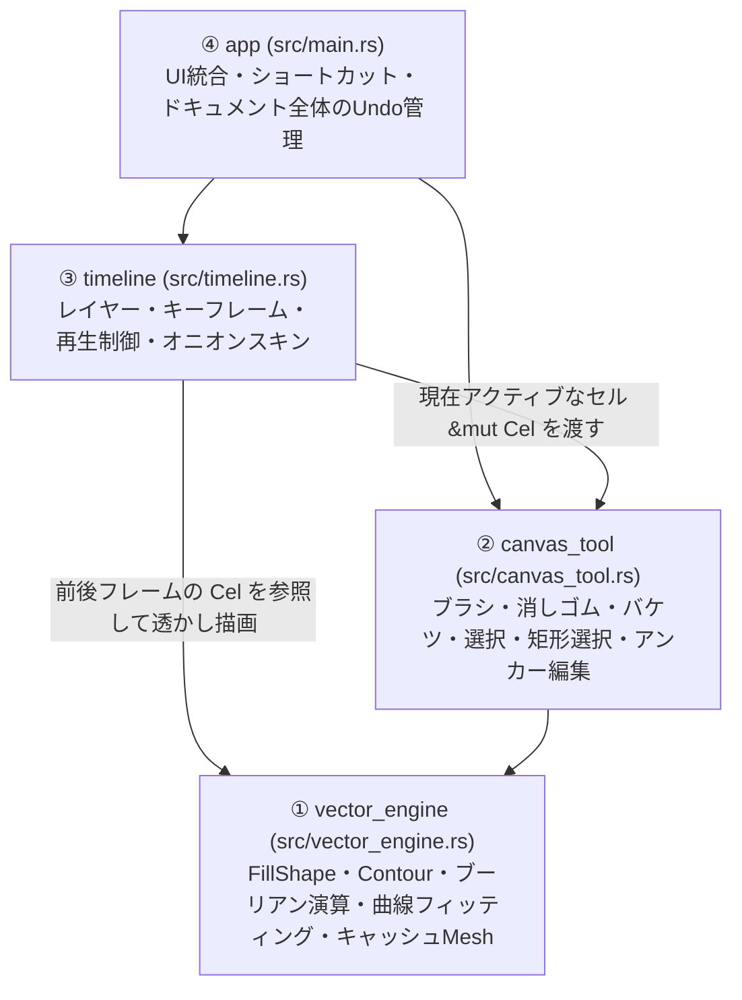

# Clay Canvas — 今後の開発方針・アーキテクチャ設計書

本ドキュメントは、ベクター描画機能の拡充からタイムライン・アニメーション制作機能の実装へ進むにあたっての設計方針（モジュール分割・データ構造・責務境界）を定義します。

---

## 1. 基本方針

- **単一プロジェクト（同一リポジトリ）で開発を継続する**
  - 2Dアニメーション制作では「オニオンスキン（前後フレームの透かし表示）」「コマ送りしながらのストローク・輪郭変形」「フレーム間での矩形選択パーツのコピー＆ペースト」など、描画機能とタイムライン機能がUX上で密接に連携するため、別プロジェクト（別リポジトリ）には切り離さない。
- **内部構造は「4層のモジュール」に厳密に分離する**
  - 1つの巨大ファイルに描画とタイムラインを混在させるのではなく、**「1枚のセル（`Cel` ＝ ベクター図形群 `Vec<FillShape>`）に対する描画・編集エンジン」** と **「レイヤー・キーフレーム・時間軸を管理するタイムライン層」** を明確に分離する。

---

## 2. 4層モジュール構成と責務



### ① `vector_engine`（純粋なベクター図形・幾何演算層）
- **責務**：タイムラインやマウスイベント、UI状態を一切知らない純粋なベクター図形データと幾何アルゴリズム。
- **主な要素**：
  - `Contour`（閉じた2次ベジェ曲線 `QuadBez` のループ、アンカー追加・削除）
  - `FillShape`（塗り色、外周・穴、グループ階層パス `group_path: Vec<u64>`、キャッシュ済み `bbox` / `bez_path` / `fill_mesh` / `selection_mesh`）
  - ブラシ軌跡からの閉輪郭生成（`generate_brush_outline_at_zoom`）と画面空間基準（ズーム不変）の2次ベジェ曲線スムージング（`build_smoothed_stroke_shapes_at_zoom`）
  - `i_overlay` による平面ブーリアン演算（`Union` / `Difference` / `Intersection`、同一色かつ同一 `group_path` のみ結合）、バケツ閉領域抽出（`find_enclosed_region_at`）、エッジ横断時の図形分割（`resolve_deformed_shape`）

### ② `canvas_tool`（1枚のセルを編集するツール・インタラクション層）
- **責務**：マウス・キーボード操作を受け取り、**外から渡された1枚のセル（`&mut Vec<FillShape>`）** に対して描画・選択・変形・グループ編集を行う。
- **主な要素**：
  - ツール状態（`Tool::Brush`, `Tool::Eraser`, `Tool::Bucket`, `Tool::Eyedropper`, `Tool::Select`, `Tool::Transform`）およびサブモード（`SelectSubMode::Reshape`, `AddAnchor`, `DeleteAnchor`）
  - 選択・変形・グループ編集状態（`selected_shapes`, `unsliced_canvas`, `selection_modified`, `editing_group_path`, `SelectDragState`, `TransformDragState`, `transform_pivot`）
  - ビューポート変換状態（`view_zoom`, `view_pan`：マウスホイール／ピンチによるカーソル中心ズーム、`Space + ドラッグ` によるパン移動、`1 px` 細ブラシの拡大描画）
  - グループ化（`Cmd+G` / 無限入れ子対応）・グループ解除（`Cmd+B`）・ダブルクリックによるインプレイス編集（背景減光＆パンくずリスト表示）
  - コピー（`Cmd+C`）・カット（`Cmd+X`）・貼り付け（`Cmd+V`：連続オフセット配置）・同じ位置に貼り付け（`Cmd+Shift+V`：グループ階層・独立ID再採番対応）
  - 矩形選択（生シェイプの部分スライス＆グループの塊選択対応）・Shift連続矩形選択・選択生シェイプへのバケツ流し込み・自由変形（拡大縮小・回転・反転・ピボット移動）・スポイト色抽出
- **設計上の重要ルール**：
  - `canvas_tool` 自身は `shapes: Vec<FillShape>` を所有せず、常にアクティブなセルへの可変参照を受け取って操作する。これにより、レイヤーやフレームが何枚に増えても描画ツールのコードを変更する必要がない。

### ③ `timeline`（レイヤー・キーフレーム・アニメーション層）
- **責務**：時間軸とレイヤー階層を持ち、「今どのセルを表示・編集するか」を管理する。
- **主なデータ構造案**：
  - `Cel`：1枚のセル画（`shapes: Vec<FillShape>`）
  - `Keyframe`：開始フレーム番号と `Cel`（空セル＝ブランクキーフレーム対応）
  - `Layer`：レイヤー名、表示/非表示フラグ、ロック状態、キーフレームのリスト
  - `Timeline`：レイヤー配列、現在のフレーム番号、現在のアクティブレイヤー、FPS、再生中フラグ、オニオンスキン設定（前後何フレームを表示するか）

### ④ `app`（アプリケーション統合・レイアウト・履歴管理層）
- **責務**：
  - 画面上部ツールバー、中央キャンバス、画面下部タイムラインパネルのレイアウト統合
  - フレーム切り替えやレイヤー切り替え時の未確定スライス（`unsliced_canvas`）の確定・復元制御
  - Undo / Redo 履歴管理とファイル保存・書き出し（SVG / 連番画像 / プロジェクトJSON等）

---

## 3. タイムラインUIの実装方式（`egui` 標準UI ＋ `Painter` カスタム描画のハイブリッド設計）

タイムラインUIは外部クレートを追加せず、現在のツールバーやキャンバスと同様に **「大枠のパネル配置と操作ボタン類は `egui` 標準ウィジェット」＋「フレームのマス目・キーフレーム記号・再生ヘッドは `egui::Painter` による直接描画」** のハイブリッド方式で構築します。

### 3.1 パネル配置と3エリア分割
`CentralPanel`（キャンバス）の前に、画面下部へリサイズ可能な `egui::TopBottomPanel::bottom("timeline")` を配置し、内部を以下の3エリアに分割します。

```text
+-----------------------------------------------------------------------+
| [▶ Play] [|<] [<] [>] [>|]  Frame: 12   FPS:[24]  [🧅 Onion] [+Layer] | ← ① 上部操作バー（標準 egui ウィジェット）
+--------------------+--------------------------------------------------+
| 👁 🔒  Layer 2     |  1   2   3   4   5 | 6 | 7   8   9  10  11  12   | ← フレーム番号ルーラー（目盛り）
|--------------------|--------------------+---+-------------------------|
| 👁 🔒 ▶ Layer 2    | [●-----------▯] [○]| ● |                         | ← ② 左側：レイヤー一覧列 ＆
| 👁 🔒   Layer 1    | [●-----------------+-▯]| [●----------▯]          |    ③ 右側：フレームグリッド（Painter描画）
+--------------------+--------------------+---+-------------------------+
                                          ▲ 赤い再生ヘッド（Playhead）
```

1. **① 上部操作バー（標準 `egui` ウィジェット）**
   - 再生／一時停止（`Enter`）、コマ送り（`<` / `>`）、現在フレーム表示、FPS設定、オニオンスキン切り替え、キーフレーム挿入（`F6`）・空白キーフレーム挿入（`F7`）・フレーム延長（`F5`）・フレーム削除（`Shift+F5`）、レイヤー追加／削除ボタンを配置。
2. **② 左側：レイヤー一覧列（幅 `180px` 程度）**
   - 各レイヤーの「表示／非表示（👁）」「ロック（🔒）」「レイヤー名」を行高さ `ROW_H`（例：`26px`）に揃えて縦に配置。
3. **③ 右側：フレームグリッド＆ルーラー領域（`egui::Painter` カスタム描画）**
   - 横軸＝フレーム（時間）、縦軸＝レイヤーのマス目領域。標準ボタンを大量生成するのではなく、`ui.allocate_exact_size()` で確保した1枚の領域に `egui::Painter` で直接描画することで、何百フレームあっても軽快に動作させる。

### 3.2 フレームグリッドの `Painter` 描画要素（Adobe Animate / Flash 方式）
1コマのサイズを固定（例：横幅 `CELL_W = 14px` × 行高さ `ROW_H = 26px`）とし、以下の視覚要素を `Painter` のプリミティブで描画します。

- **キーフレーム区間（スパン）の背景**：`painter.rect_filled()` / `painter.rect_stroke()` で描画（絵がある区間は白〜薄グレー、現在選択中のコマは水色ハイライト）。
- **キーフレーム記号**：
  - **絵があるキーフレーム**：マス目中央下寄りに黒丸 `●`（`painter.circle_filled()`）
  - **空白キーフレーム（Blank Keyframe）**：白抜き丸 `○`（`painter.circle_stroke()`）
  - **延長フレーム（Hold Frame）の終端**：スパン右端のマスに小さな縦長四角 `▯`（`painter.rect_stroke()`）
- **フレーム番号ルーラー**：上端行に `1, 5, 10, 15...` のフレーム番号と目盛り線を描画。
- **再生ヘッド（Playhead）**：現在のフレーム列に赤い上部マーカー矩形と、全レイヤーを縦に貫く赤い縦線（`painter.line_segment()`）を最前面に描画。

### 3.3 マウス当たり判定とキャンバス連動
1コマの幅 `CELL_W` と行高さ `ROW_H` が一定であるため、マウス座標から **単純な割り算（$O(1)$）** で操作対象のレイヤーとフレームを算出します。

- `layer_idx = ((mouse_y - grid_top) / ROW_H) as usize`
- `frame_idx = ((mouse_x - grid_left + scroll_x) / CELL_W) as usize`

- **クリック操作**：対象の「レイヤー × フレーム」をアクティブ化し、中央キャンバスが参照するセル（`Vec<FillShape>`）を即座に切り替える。
- **左右ドラッグ（スクラブ再生）**：ルーラーやグリッド上でマウスを左右にドラッグすると再生ヘッドがリアルタイムに追従し、パラパラ漫画のようにキャンバス上の絵が切り替わる。
- **オニオンスキン描画**：現在のフレームの前後数コマの `FillShape` が持つキャッシュ済み `fill_mesh` を半透明（または前コマ＝青み、次コマ＝緑み）に変換し、アクティブなフレームの背面に重ねて描画する。

---

## 4. 開発ステップ（ロードマップ）

1. **フェーズ 1：単一キャンバスでの描画・造形ツールの完成（完了）**
   - ブラシ（`1 px`〜`70 px`、1px刻み、ズーム不変の画面空間スムージング）、消しゴム、バケツ（閉領域塗り・選択生シェイプ限定塗り）、スポイト、選択・輪郭つまみ変形、エッジ横断による図形分割、アンカー追加/削除、矩形選択＆Shift連続矩形選択、自由変形（拡大縮小・回転・反転・ピボット移動）、グループ化/解除（無限入れ子・ダブルクリックによるインプレイス編集）、コピー＆ペースト（`Cmd+C` / `Cmd+X` / `Cmd+V` / `Cmd+Shift+V`）、ビューポートのズーム＆パン移動。
2. **フェーズ 2：モジュール分割リファクタリング（完了）**
   - `src/main.rs` を `src/vector_engine.rs` / `src/canvas_tool.rs` / `src/timeline.rs` / `src/main.rs` の4モジュールに分割し、`Timeline` / `Layer` / `Keyframe` / `Cel` データ構造を整備（全17件の単体テストを維持）。
3. **フェーズ 3：タイムライン・アニメーション基本機能の実装**
   - 下部タイムラインUI、キーフレーム追加・削除・複製、`<` / `>` キーでのコマ送り、再生プレビュー、オニオンスキン表示、レイヤー管理。
