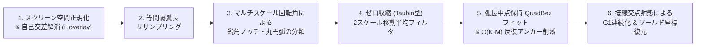

# is2d — 描画・幾何・補間アルゴリズムの数学的根拠

本ドキュメントは、is2d において Adobe Animate（旧 Macromedia Flash）のマージ描画・ベクターブラシ・輪郭粘土変形・クラシックトゥイーン補間を実現している幾何アルゴリズムと数学的根拠をまとめた技術仕様書です。
（※ 操作ガイドは [`DOCUMENT.md`](./DOCUMENT.md)、状態の持ち方・データの流れなどの設計は [`ARCHITECTURE.md`](./ARCHITECTURE.md) を参照してください。）

---

## 1. ベクター図形の表現と基本幾何演算（`Contour` / `FillShape`）

### 1.1 2次ベジェ曲線（`QuadBez`）による閉輪郭表現
Adobe Animate と同じく、すべての図形輪郭（[`Contour`](./src/vector_engine.rs)）を3次ベジェではなく **2次ベジェ曲線（Quadratic Bézier Curve）** の閉じたチェインとして表現します。2次ベジェ曲線は制御点 $P_1$ が1つだけであり、「曲線の途中をつまんで引っ張る」操作に対して制御点が一意に決まるという幾何学的な利点があります。

各セグメント $i \in \{0, \dots, N-1\}$ は始点 $P_{0,i}$、制御点 $P_{1,i}$、終点 $P_{2,i}$ を持ち、パラメータ $t \in [0, 1]$ に対して次式で定義されます。

$$B_i(t) = (1-t)^2 P_{0,i} + 2(1-t)t P_{1,i} + t^2 P_{2,i}$$

1階微分（接線ベクトル）は次式となります。

$$B_i'(t) = 2(1-t)(P_{1,i} - P_{0,i}) + 2t(P_{2,i} - P_{1,i})$$

閉ループの $C^0$ 連続条件として、隣接セグメント間で常に $P_{2,i} = P_{0,(i+1)\bmod N}$ を保証します（[`Contour::enforce_continuity`](./src/vector_engine.rs)、[`Contour::from_segments_oriented`](./src/vector_engine.rs)）。

### 1.2 De Casteljau 分割による形状不変アンカー追加と削除
アンカーの追加・削除は、地図の辺に対して行います（[`PlanarMap::with_anchor_added`](./src/planar_map.rs) / [`PlanarMap::with_anchor_deleted`](./src/planar_map.rs)）。動かして浮いている片は、そのレイヤーの片だけで作った地図で、ほかの図形はレイヤーの地図で行います。境目の線は1本なので、両側の図形に同じ頂点が入り、同じ頂点が消えます。
- **アンカー追加**：辺の上のクリックした所のパラメータ $t$ で De Casteljau のアルゴリズムを適用し、元の曲線形状を一切変えずに2つの2次ベジェ曲線 $[0, t]$ と $[t, 1]$ に厳密分割します。
  $$Q_0 = (1-t)P_0 + t P_1, \quad Q_1 = (1-t)P_1 + t P_2, \quad R = (1-t)Q_0 + t Q_1 = B(t)$$
  分割後の左セグメントは $(P_0, Q_0, R)$、右セグメントは $(R, Q_1, P_2)$ となり、合成曲線は元の $B(t)$ と数学的に完全一致します。足せるのは、分けた2本の判定の形（4.1.1）が別々の折れ線になり、つながりが変わらない所だけです（端に近すぎて、新しい頂点が端と同じ格子の点に丸まる所などは断られます）。
- **アンカー削除**：指定アンカーの前後の辺を、中点制御点 $P_1 = \frac{1}{2}(P_0 + P_2)$ を持つ直線2次ベジェ1本で結びます。つながる辺が2本で、直線がほかの線と交わらず・ほかの頂点や辺をまたがず、両側の面が潰れも裏返りもしないときだけ行います。

### 1.3 符号付き面積とワインディング規約
[`Contour::signed_area`](./src/vector_engine.rs) では各セグメントを8等分評価した頂点列 $(V_0, V_1, \dots, V_{M-1})$ に対し、**Shoelace（測量士）の公式** を直接適用して符号付き面積 $A$ を算出します。

$$A = \frac{1}{2} \sum_{k=0}^{M-1} (V_{k,x} V_{k+1,y} - V_{k+1,x} V_{k,y}) \quad (V_M = V_0)$$

- **外周輪郭（`exterior`）**：$A > 0$（画面座標系で時計回り）
- **内周穴輪郭（`holes`）**：$A < 0$（画面座標系で反時計回り）

---

## 2. アルゴリズム 1：丸ブラシ軌跡からの厳密なオフセット包絡線生成

[`generate_brush_outline_at_zoom`](./src/vector_stroke.rs) は、マウスドラッグで得られた中心点列（スパイン） $(C_0, C_1, \dots, C_{n-1})$ とブラシ半径 $r$ から、半径 $r$ の円盤が中心線に沿って掃引する領域（各区間のカプセル $\{\,q : \operatorname{dist}(q, \overline{C_i C_{i+1}}) \le r\,\}$ の和集合）の輪郭を、NonZero で塗る1本の閉ポリゴンとして生成します。

1. **スクリーン空間基準の最小ステップ間引き**：
   現在のズーム倍率を $z \in [0.15, 16.0]$ としたとき、スクリーン上のブラシ半径 $r_{\text{screen}} = r \cdot z$ に比例する最小サンプリング間隔
   $$d_{\min} = \frac{\operatorname{clamp}(0.15 \, r_{\text{screen}},\; 0.2,\; 0.8)}{z}$$
   未満の重複入力点と、非有限な座標を除去します。
2. **中心線の間引き（RDP）**：
   許容ずれ $\varepsilon = \operatorname{clamp}(0.03 \, r_{\text{screen}},\; 0.5,\; 2.0) / z$ の Ramer–Douglas–Peucker 法で中心線の点を間引きます。間引いた中心線は元の中心線から $\varepsilon$ 以内にあるので、掃引領域の変化も $\varepsilon$ 以内（スクリーン上で半径の 3%、0.5〜2px）です。手描きの点は 1px ほどの間隔で並ぶため、間引かないと手順 4 の折り返しが多くなり、線が自分と重なる所で自己交差の解消（`simplify_shape`、NonZero）が重くなります。
3. **単位接線ベクトルと左法線ベクトル**：
   各線分区間 $i \in \{0, \dots, n-2\}$ について単位接線 $T_i$ と左単位法線 $N_i$ を求めます。
   $$T_i = \frac{C_{i+1} - C_i}{\|C_{i+1} - C_i\|}, \quad N_i = (-T_{i,y},\; T_{i,x})$$
4. **外側の Round Join（円弧）と内側の中心点折り返し**：
   各中間頂点 $C_i$ の折れ角 $\theta_i = \operatorname{atan2}(T_{i-1} \times T_i,\; T_{i-1} \cdot T_i)$ について、角度の大小に関係なく、すべての頂点で次のように点を置きます。
   - ターンの**外側（凸側）** には、角度 $|\theta_i|$ をステップ数 $S = \operatorname{clamp}(\lceil |\theta_i| / (\pi/12) \rceil, 1, 16)$ で分割した半径 $r$ の円弧点列を挿入します。
     $$P_{\text{arc}}(a) = C_i + r \left( \mp N_{i-1} \cos a + T_{i-1} \sin a \right) \quad (0 \le a \le |\theta_i|)$$
   - ターンの**内側（凹側）** は、$C_i \pm r N_{i-1} \to C_i \to C_i \pm r N_i$ と、中心点 $C_i$ を通って折り返します。
   こうすると、輪郭の巻き数は「各区間の長方形 $[C_i, C_{i+1}] \times [-r, r]$」「各頂点の外側の扇形」「両端の半円」の巻き数の和にちょうど分解でき、どれも同じ向きなので、NonZero で塗った領域はそれらの和集合になります。外側の扇形は、頂点の円盤のうち前後の長方形で覆われない部分にちょうど一致するので、和集合は掃引領域（カプセルの和集合）そのものです（区間が短く、円盤の一部が前後の長方形からはみ出す場合も、その点はより近い別の頂点の円盤に含まれ、同じ理由で覆われます）。手ぶれや角の行き過ぎで向きが細かく変わっても、切れ込みはできません。
5. **始点・終点の 180° Round Cap（半円キャップ）**：
   始点 $C_0$ は最初の区間の向き $T_0$、終点 $C_{n-1}$ は最後の区間の向き $T_{n-2}$ に合わせた16分割の半円弧（$\angle \in [0, \pi]$）で閉じます。区間の帯とすき間なくつながり、両端は半径 $r$ の円になります。

ドラッグ中のプレビュー（`tessellate_raw_polygon`、lyon の NonZero）も、確定時の自己交差解消（`simplify_shape`、NonZero）も、この輪郭を NonZero で塗るので、どちらも同じ掃引領域になります。

---

## 3. アルゴリズム 2：軌道・形を変えない Adobe Animate 方式 2次ベジェ輪郭構築

[`build_smoothed_stroke_shapes_at_zoom`](./src/vector_stroke.rs) および [`smooth_ring_to_quad_contour`](./src/vector_stroke.rs) は、生のブラシ輪郭ポリゴンから「手描きの軌道・線幅・小さな円の形・丸キャップ」をそのまま保ちつつ、ピクセルジャギーの除去と不要な中間アンカーの削減のみを行う6段階のパイプラインです。

### 3.1 スクリーン空間正規化によるズーム不変性
100% 表示時と 400%〜1600% 拡大描画時でスムージングの強さやアンカー削減挙動が変わってしまう問題を防ぐため、入力されたワールド座標の輪郭点列 $P_{\text{world}}$ を最初に現在のズーム倍率 $z$ でスクリーン座標（px 単位）へ変換します。

$$P_{\text{screen}} = z \cdot P_{\text{world}}$$

以降の自己交差解消（`simplify_shape`）・ブラシ半径推定・リサンプリング（[`resample_closed_ring_uniform`](./src/vector_stroke.rs)）・平滑化・ベジェ近似のすべてを **スクリーン空間（px 基準）** で実行し、完成した [`Contour`](./src/vector_engine.rs) に最後だけ逆スケール変換 $z^{-1}$ を適用します。これにより、どのズーム倍率で描いても画面上の見た目に合わせた実用上同じ形が得られます（2のべき乗以外のズームでは浮動小数点演算の丸めにより $10^{-13}$ 程度の差が出ます）。

### 3.2 Steiner の管状近傍公式によるブラシ半径推定と小円保護スケーリング
自己交差解消後のポリゴンリング群（外周＋内周穴）の正味面積 $A_{\text{net}}$ と総周長 $L$ から、[`estimate_brush_radius_from_shape_rings`](./src/vector_stroke.rs) にてスクリーン空間での実効ブラシ半径 $r_{\text{est}}$ を推定します。

- 長さ $\ell$、半径 $r$ のストロークの面積は $A \approx 2r\ell + \pi r^2$、周長は $L \approx 2\ell + 2\pi r$ であるため、**Steiner の管状近傍公式** より比 $A / L$ はブラシ半径 $r$ に比例します（$r \approx 1.05 \, A_{\text{net}} / L$）。
- 一方、スタンプや小さな円塊のように**等周商（Circularity）**
  $$C = \frac{4\pi A_{\text{net}}}{L^2} > 0.78$$
  が高い単一リングでは、円の面積・周長比 $A / L = r / 2$ に従い $r_{\text{est}} = 2 A_{\text{net}} / L$ として正確に半径を復元します。

さらに、各リング自身の周長半径 $R_{\text{ring}} = L_{\text{ring}} / 2\pi$ からスケール係数 `r_scale` と小ループ保護係数 `small_ring_factor` を算出します（[`smooth_ring_to_quad_contour`](./src/vector_stroke.rs)）。

$$r_{\text{scale}} = \min\!\left(\operatorname{clamp}\!\left(\frac{r_{\text{est}}}{8.0},\; 0.05,\; 1.5\right),\; \operatorname{clamp}\!\left(\frac{R_{\text{ring}}}{20.0},\; 0.05,\; 1.5\right)\right), \quad f_{\text{small}} = \operatorname{clamp}\!\left(\frac{R_{\text{ring}}}{42.0},\; 0.25,\; 1.0\right)$$

これにより、細ペンや小さな円・小さな内周穴では平滑化窓や近似許容誤差が自動的に最大 $1/4$ まで縮小され、小さな円が勝手に変形されたり潰れたりすることを防ぎます。

### 3.3 マルチスケール回転角による特徴点（鋭角ノッチ・丸キャップ・丸コーナー）の分類とロック頂点抽出
等間隔弧長ステップ $\Delta s$ でリサンプリングされた頂点列 $D_0, \dots, D_{m-1}$ に対し、[`classify_and_align_ring_features`](./src/vector_stroke.rs) では4つの空間スケール窓（$1$, $w_{\text{short}} \approx 4 r_{\text{scale}} / \Delta s$, $w_{\text{local}} \approx 6 r_{\text{scale}} / \Delta s$, $w_{\text{macro}} \approx 18 r_{\text{scale}} / \Delta s$）で符号付き回転角を計測します。

$$\theta_w(i) = \operatorname{atan2}\!\left(\hat{d}_{\text{in}}(i, w) \times \hat{d}_{\text{out}}(i, w),\; \hat{d}_{\text{in}}(i, w) \cdot \hat{d}_{\text{out}}(i, w)\right)$$

1. **鋭角コーナー・自己交差V字ノッチ（`is_sharp_corner`）の検出（[`detect_sharp_corners`](./src/vector_stroke.rs)）**：
   丸ブラシの外周（`is_exterior == true`）における凸方向の回転（$\theta_{w_{\text{short}}} \cdot \operatorname{sign}(A) > 0$）は必ず半径 $r$ の円弧であるため1点の鋭角から除外し、自己交差くびれ（凹方向のV字ノッチ）や内周穴の角のみを局所ピーク判定で1点ロックします。
2. **丸キャップ・局所丸コーナー（`is_round_arc`）の検出と検証（[`detect_round_arcs`](./src/vector_stroke.rs), [`filter_protected_round_features`](./src/vector_stroke.rs)）**：
   3スケール（$\theta_{\text{short}}, \theta_{\text{local}}, \theta_{\text{macro}}$）がすべて同符号かつ閾値を超える連続区間を丸円弧候補として抽出し、区間全体のネット回転角 $\Theta_{\text{net}} \ge 1.85\text{ rad}$ のものを **180° 丸キャップ**、前後のフランジ（側面）曲率が低く局所に集中しているものを **丸コーナー** として保護します。
   ただし、鋭角を持たず全周の $60\%$ 以上が `is_round_arc` となる図形は「手描きの円・楕円ループ」であるため、一部だけをキャップと誤認して歪めないよう `is_round_arc` を全解除して全周を均一に扱います。
3. **保護ランの出入口・中点ロック（[`select_locked_feature_anchors`](./src/vector_stroke.rs)）**：
   平滑化後の輪郭上で、鋭角ピークは1点ロックし、丸コーナーおよび丸キャップの連続ラン（`is_high_curv && !is_sharp_corner`）は出入口アンカー（`i_start`, `i_end`）および $\Theta_{\text{net}} > 1.75\text{ rad}$ の丸キャップ中点をロックします。

### 3.4 ゼロ収縮（Zero-Shrinkage / Taubin 型）2スケール移動平均フィルタ
通常の移動平均（ラプラシアン平滑化）を閉曲線に反復適用すると、曲率ベクトル方向に頂点が内側へ移動し、円や角が痩せて形が変わってしまいます。これを防ぐため、[`apply_zero_shrinkage_smoothing`](./src/vector_stroke.rs) では **狭窓変位から広窓変位（大局的な曲率ドリフト）を差し引く2スケール・バンドパスフィルタ** を採用しています。

1. **狭窓平均変位（高周波ジャギー＋大局曲率）**：
   高曲率特徴点からの距離 $d_{\text{hc}}(i)$ に応じて窓幅 $w = \min(d_{\text{hc}}(i), 3)$ を定め、近傍平均への変位ベクトル $\Delta_{\text{narrow}}(i)$ を求めます。
   $$\Delta_{\text{narrow}}(i) = \frac{1}{2w} \sum_{k=1}^{w} \left(D_{i-k} + D_{i+k}\right) - D_i$$
2. **広窓平均変位（大局曲率ドリフト成分の推定）と減衰付き差し引き**：
   より広い窓 $w_{\text{wide}} \le 6$ で $\Delta_{\text{narrow}}$ の移動平均 $\Delta_{\text{wide}}(i)$ を計算し、高曲率特徴点付近で減衰する係数 $\operatorname{fade}(i) = \operatorname{clamp}(d_{\text{hc}}(i) / 2.0,\; 0,\; 1)$ を掛けて高周波のピクセル階段ノイズ成分のみを抽出し、1パスあたり係数 $0.50$ で減衰更新します（$D_i \leftarrow D_i + 0.50\,\Delta_{\text{eff}}(i)$）。
   $$\Delta_{\text{eff}}(i) = \left(\Delta_{\text{narrow}}(i) - 1.02 \, \Delta_{\text{wide}}(i)\right) \cdot \operatorname{fade}(i)$$
3. **サブピクセル変位クランプ（軌道不変保証）**：
   4パスの反復中、元のリサンプリング頂点 $D_i^{(0)}$ からの累積移動距離を最大
   $$\left\|D_i - D_i^{(0)}\right\| \le 0.45 \cdot r_{\text{scale}} \cdot f_{\text{small}} \cdot \operatorname{fade}(i) \quad (\text{標準ブラシで最大 } 0.45\text{ px、小円で最小 } 0.11\text{ px})$$
   に厳密クランプします。これにより、描いたストロークの軌道や小さな円の形は維持され、マウス座標の整数丸めによるサブピクセルのギザギザだけが滑らかに整えられます。

### 3.5 弧長中点補間＋最小二乗法のハイブリッド制御点決定
アンカー区間 $Q_0, Q_1, \dots, Q_{n-1}$（始点 $P_0 = Q_0$、終点 $P_2 = Q_{n-1}$、総弧長 $L$）に1本の2次ベジェ曲線を当てはめる際、[`fit_quad_control_point_with_arc_lengths`](./src/vector_stroke.rs) では以下の2つの制御点を $1:1$ でブレンドします。

1. **弧長中点 $M$ を厳密に通過する制御点 $P_{1,\text{mid}}$**：
   累積弧長 $s_i$ から $s = L/2$ に対応する輪郭上の弧長中点 $M$ を線形補間で求め、$B(0.5) = \frac{1}{4}P_0 + \frac{1}{2}P_1 + \frac{1}{4}P_2 = M$ を満たす制御点を逆算します。
   $$P_{1,\text{mid}} = 2M - \frac{1}{2}(P_0 + P_2)$$
2. **弦長パラメータ最小二乗法による制御点 $P_{1,\text{ls}}$（[`fit_quad_control_point_least_squares`](./src/vector_stroke.rs)）**：
   各内点 $Q_i$ の正規化弧長パラメータ $t_i = \operatorname{clamp}(s_i / L,\; 0.05,\; 0.95)$ に対し、バーンスタイン基底 $B_0(t) = (1-t)^2$, $B_1(t) = 2(1-t)t$, $B_2(t) = t^2$ を用いて二乗誤差 $\sum_{i=1}^{n-2} \|B(t_i) - Q_i\|^2$ を最小化する閉形式解を算出します。
   $$\frac{\partial}{\partial P_1} \sum_{i=1}^{n-2} \|B(t_i) - Q_i\|^2 = 0 \implies P_{1,\text{ls}} = \frac{\sum_{i=1}^{n-2} B_1(t_i)\left(Q_i - B_0(t_i)P_0 - B_2(t_i)P_2\right)}{\sum_{i=1}^{n-2} B_1(t_i)^2}$$
3. **ハイブリッド制御点**：
   $$P_1 = \frac{1}{2} P_{1,\text{mid}} + \frac{1}{2} P_{1,\text{ls}}$$
   最小二乗法単独では丸キャップや深いカーブで頂点がわずかに内側へ痩せる性質がありますが、$P_{1,\text{mid}}$ と合成することで中点通過精度と全体の二乗誤差最小化を両立します。

### 3.6 ニュートン1ステップ射影誤差と $O(K \cdot M)$ 反復アンカー削減
[`reduce_outline_anchors_by_quad_fit`](./src/vector_stroke.rs) では、ロックされていない中間アンカー候補 $a_j$ を削除して前後区間 $a_{j-1} \to a_{j+1}$ を1本の `QuadBez` に統合できるかを判定します。

- **回転量および変曲点（S字カーブ）による棄却ガード**：
  区間の正味回転角 $\Theta_{\text{net}}$ と4分割マクロ絶対回転角の和 $\Theta_{\text{macro}}$ について、$\Theta_{\text{macro}} > 0.35\text{ rad}$ かつ $\Theta_{\text{macro}} - \Theta_{\text{net}} > 0.24\text{ rad}$ となる折り返し区間、および回転角上限 $\theta_{\max}$（高曲率点で $1.68\text{ rad}$、それ以外で $0.82 + 0.40 f_{\text{small}}\text{ rad}$）に対して $\Theta_{\text{net}} > \theta_{\max}$ または $\Theta_{\text{macro}} > \theta_{\max} + 0.25\text{ rad}$ を超える区間は統合を棄却します。また、2次ベジェ曲線は単一セグメント内に変曲点を持てないため、弦 $P_0 P_2$ の法線方向符号付き距離の前半平均 $\bar{d}_1$ と後半平均 $\bar{d}_2$ が異符号（$\bar{d}_1 \cdot \bar{d}_2 < 0$）かつ共に $0.72 \cdot \text{tol}$ を超えるS字区間も統合を棄却します。
- **ニュートン1ステップ射影による高速最大距離誤差（[`max_quad_fit_error_with_arc_lengths`](./src/vector_stroke.rs)）**：
  各点 $Q_i$ の初期パラメータ $t_0 = s_i / L$ に対し、曲線の接線ベクトル $B'(t_0)$ への正射影でパラメータを1ステップ精密化します。
  $$t_1 = \operatorname{clamp}\!\left(t_0 + \frac{(Q_i - B(t_0)) \cdot B'(t_0)}{\|B'(t_0)\|^2},\; 0,\; 1\right), \quad \varepsilon_{\max} = \max_{1 \le i \le n-2} \min\!\left(\|Q_i - B(t_1)\|,\; \|Q_i - B(t_0)\|\right)$$
- **差分更新による $O(K \cdot M)$ 優先度削減**：
  許容誤差 $\varepsilon_{\max} \le \text{tol}$（側面で $0.50 \cdot r_{\text{scale}} \cdot f_{\text{small}}$ px、丸キャップ・高曲率部で $\max(0.36 \cdot r_{\text{scale}} \cdot f_{\text{small}},\; 0.06)$ px）を満たす候補のうち、スコア $\varepsilon_{\max} + 0.18 \, \Theta_{\text{net}}^2$ が最小のアンカーから順に削除します。アンカー $j$ を削除した際、区間が変化するのは前後の隣接2アンカー（$j-1$ と $j+1$）のみであるため、この2箇所のスコアのみを再計算することで $O(K \cdot M)$ の高速性を実現しています。

### 3.7 接線交点射影による $G^1$ 連続化
[`enforce_g1_tangent_continuity_on_segments`](./src/vector_stroke.rs) では、鋭角でも直線接続でもない滑らかな中間アンカー $A_j$ において、前セグメントの終端接線方向 $\hat{d}_{\text{in}}$、次セグメントの始端接線方向 $\hat{d}_{\text{out}}$、および密な輪郭上の弦方向 $\hat{d}_{\text{ring}}$ の平均単位接線ベクトル $\hat{T}_j$ を求めます。

セグメント $j$ の両端アンカー $P_0, P_2$ に共通接線ベクトル $\hat{T}_0, \hat{T}_2$ が定義されているとき、2直線の交点条件

$$P_0 + s_0 \hat{T}_0 = P_2 - s_2 \hat{T}_2 \implies s_0 = \frac{(P_2 - P_0) \times \hat{T}_2}{\hat{T}_0 \times \hat{T}_2}, \quad s_2 = \frac{\hat{T}_0 \times (P_2 - P_0)}{\hat{T}_0 \times \hat{T}_2}$$

から候補制御点 $P_{1,\text{tan}} = P_0 + s_0 \hat{T}_0$（ただし $|\hat{T}_0 \times \hat{T}_2| > 0.04$ かつ $s_0, s_2 \in (0.08\,\|P_2 - P_0\|,\; 1.80\,\|P_2 - P_0\|)$）を求め、初期制御点 $P_1$ からの中点法線変位 $\frac{1}{2}|(P_{1,\text{tan}} - P_1) \cdot N_{\text{chord}}|$ が $\min(0.85\,r_{\text{scale}},\; 0.024\,\|P_2 - P_0\|)$ 以内、かつ制御点の総移動量 $\|P_{1,\text{tan}} - P_1\|$ が $0.36\,\|P_2 - P_0\|$ 以内の場合に採用することで、形状を変えずにアンカー接続部の微小な角度折れを解消します。

---

## 4. アルゴリズム 3：境目の線で持つ地図と、形・地図の重ね合わせ

生の図形を書き換える操作（ブラシ・消しゴム・バケツ・矩形で一部を選ぶ・持ち上げた片を置く・貼り付け・輪郭の変形・アンカーの追加と削除）は、すべて同じレイヤー・同じ階層の生の図形の地図で行います（Adobe Animate のマージ描画と同じ持ち方）。図形どうしのブール演算は使いません。

### 4.1 境目の線で持つ地図（[`PlanarMap`](./src/planar_map.rs)）
輪郭の変形・アンカーの追加と削除、そのカーソル合わせは、同じレイヤー・同じ階層の生の図形を、頂点と辺（曲線・左の色・右の色）で持つ地図で行います（Adobe Animate のマージ描画と同じ持ち方。選択中の図形は地図に入れません）。本番は図形から地図を作りません（新しい中身も地図とインスタンスで運ぶ：4.3）。境目は1本なので、辺を動かせば両側の面が一緒に変わり、3色以上が接する点は頂点になって動きません。面は、頂点で時計回りに次の辺を選んで輪郭をたどって取り出します（[`face_cycles_with`](./src/planar_map.rs)。頂点のまわりの辺の順番は、判定の形の、頂点から出る最初の区間の整数の向きで決める）。確定した地図はセル画の地図になり、面の図形は変わった面だけが新しくなります（[`rewrite_shapes`](./src/planar_map.rs)）。セル画が持つのは地図だけで（面の図形は地図から作る写し）、ドラッグのあいだは、始めたときのセル画の地図を使います（カーソル合わせでは図形が変わるまで使い回し）。ドラッグ中も、離したときと同じ計算（[`reshape_result`](./src/planar_map.rs)：重ね合わせ（5.2）・`rewrite_shapes`）をして、その結果（消す元の図形と新しく入れる面）を仮表示します。離す点を勝手に押し出すことはせず、反対側の輪郭線を越えたときだけ分かれます。ドラッグ中の見た目と離した後の形は必ず同じで、図形の並び（昔の重ね順）は表示にも出ません。ドラッグのあいだ変わらない元の地図の辺の鍵は、ドラッグを始めるときに1回だけ求めます（[`ReshapeBase`](./src/planar_map.rs)）。

### 4.1.1 判定の形（格子の上の折れ線）
地図のつながり（頂点のまわりの辺の順番）・外周か穴か・辺の交わりは、全部、各辺の「判定の形」1つで、整数の計算で決めます。曲線は絵のためだけに使います。判定の形は、曲線を重ね合わせ（4.2）と同じ数に等分した折れ線（曲線とのずれ $0.002$ 以内）の点を、$1/4096$ px の格子の点に丸め、続けて同じ点になったものを1つにしたものです（`grid_poly`。同じ曲線からはいつも同じ折れ線ができる）。

正しい地図（[`is_valid`](./src/planar_map.rs)）は、判定の形が次をすべて満たすことです。①折れ線どうしは、共有する頂点のほかで交わらない・触れない・重ならない（共有する頂点から同じ向きに出る2本も重なりとみなす）、②1本の折れ線は自分と触れない、③別々の頂点は別々の格子の点に丸まる、④面の輪郭が閉じて左の色がそろう、⑤色のある穴には、それを入れる同じ色の外周がある、⑥何も無い側の輪郭が、色のある面の中に入り込まない。①〜③は外積の符号で、外周か穴かは折れ線の多角形の面積（整数の和）の符号で、穴の入れ先と⑥は折れ線の多角形での点の巻き数（輪郭を2倍の座標で横の帯に分け、半開区間で数える `GridPolygon`。点が輪郭の上にあれば正しくない）で決めます。座標は $\pm 2^{28}$ なので、外積は `i128`、面積の和も `i128` に収まります。面を外周と穴の組に分けるのは1つの関数（`regions`：穴は、それを含む同じ色のいちばん小さい外周に入れる。色の無い囲まれた所も組にできる）、輪郭の内外は1つの判定（`Ring::contains`）で、面の取り出し（⑤）・⑥・バケツの塗る面は、どれもこれで決めます。

地図の一部の辺（頂点 $a$ から途中の頂点を通って $b$ へつながる道 $P$）を、$a$ から $b$ への1本の曲線 $C$ に置き換えてよいのは、$C$ の判定の形について次の3つを満たすときだけです（[`PolyIndex::can_replace`](./src/planar_map.rs)。重ね合わせで曲線に戻すとき・2本の辺をまとめるとき・アンカーを足す・消すときに使う）。①$C$ の折れ線が、自分とも、ほかの辺の折れ線とも、共有する端のほかで触れない、②$P$ と $C$ の折れ線で囲まれた所（境目の上を含む）に、ほかの頂点が無い、③$a$・$b$ につながるほかの辺の最初の区間の真ん中が、囲まれた所（境目の上を含む）に無い（頂点のまわりの順番が変わらない）。囲まれた所に何も無く、$C$ がほかに触れなければ、つながりは変わらず、両側の面も潰れも裏返りもしません。

### 4.2 形・地図を地図に重ねる（[`PlanarMap::overlay`](./src/planar_map.rs)）
ブラシ・消しゴム（形を重ねる）、バケツ（面を塗る：[`with_face_filled`](./src/planar_map.rs)）、矩形で一部を選ぶ（[`cut_out`](./src/planar_map.rs)。レイヤーの中身（残りの地図か、セル画の地図）を、選んでいる面と矩形を合わせた所で1回だけ切る：[`Floating::cut`](./src/floating.rs)）、持ち上げた片を置く・貼り付け（残りの地図に片の地図を重ねる：[`commit_floating_layers`](./src/canvas_tool.rs)）、輪郭の変形の確定（5.2）は、同じレイヤー・同じ階層の生の図形の地図で行い、セル画の地図を受け取って地図を返し、形の変わった図形だけを書き換えます（[`Cel::edit_map`](./src/timeline.rs)・[`rewrite_shapes`](./src/planar_map.rs)：面のすべての辺が変わらず、側に記された元の図形が1つで、その図形のどの辺も消えていない面は、元の図形のまま残し、それ以外の面は新しい図形にする。残した面の元の図形のほかはみな消す。新しい図形のうち、辺の側に記された元の図形がみな同じ1つの面は、その元の図形の番号を引き継ぐ（同じ元の図形を引き継ぐ面が2つ以上あれば、その印の付いた側がいちばん多い面）。形の変わった図形の番号が変わらないので、地図のその面のほかの辺の印も変わらず、しまう地図では変わった場所の塊だけが新しくなる。矩形で選んで持ち上げる片と残りは、隠す元の図形とは別の新しい図形なので、番号を新しく振る）。持ち上げた片を置くときも、セル画の地図と比べて書き換えるので、片の面は新しい図形になります（辺の側の印が片の番号なら、その番号を引き継ぐ）。重ねるものは塗りの形か地図か輪郭の変形で動かした辺で、色の決め方は4つです（`MapRule`：中をこの色にする／中だけ残す／重ねる地図の色を上に置く／動かしたことによる巻き数の変わり方で決める（5.2））。結果は正しい地図（辺が端のほかで交わらず、面の輪郭が閉じて色がそろう）になるように作り、ほかのやり方に切り替えたりはしません。文書に書き戻すときは、読み込みと同じ1つの判定（[`PlanarMap::valid_faces`](./src/planar_map.rs)：正しい地図なら、その面を返す）で確かめ、正しくなければ書かずに断ります（書けた地図は、保存して開いても必ず読める）。

1. **入れる辺を決め、折れ線にして格子に置き、交わる所で切る**：重ねる線と前からある辺を、曲線とのずれ $0.002$ 以内の折れ線にし、$1/4096$ px の整数の格子に置いて、i_overlay の `EdgeOverlay` で交わる所で切ります。交わりは整数で計算するので、ほぼ重なった線でも食い違いません。前からある辺と重ねる線（形の線・輪郭の変形の線でも、重ねる地図の辺でも）が、どこでも $0.002$ px 以内に重なる所（`Span`。どちらがどちらに含まれても、端の一部どうしが重なってもよい）は同じ線として扱い、その所は2本とも、前からある辺のその所を切り出した曲線の同じ折れ線にします（`overlap`・`stitched`。重なる所の端で辺が切れる。その2本はいつも入れる）。地図は曲線を $0.002$ px の精度でしか表さないので、それより近い2本は同じ線です。こうしないと、切り方の違う同じ曲線（前の重ね合わせで切られて部分の曲線になった辺と、同じ形を描き直した曲線。切り出した片の辺と、切る前の元の辺）では折れ線の点の位置が違い、折れ線どうしが格子の数目の幅で何度も交わって、見えない欠片の面が境目に沿ってできたり、境目が細かい直線に割れたりする（同じ形を描き直す・同じ形の消しゴムで消す・切り出した片をその場に貼る、を重ねるほど増える）。重なる所は、2本の端のうち相手から $0.002$ px 以内にあるものを重ねる線の上の $t$ で並べ、その最初から最後までで、2本のその所を切り出した曲線（同じ曲線の部分なら $t$ は1次式で対応する）の3組の制御点が、みな $0.002$ px 以内かで決めます（`same_curve`。2本の差も2次ベジェで、曲線の点は制御点の重みつきの平均なので、どこでも2本の離れ具合は制御点の離れ具合以下になる。両側に同じ決まりがかかり、折れ線の細かさによらない。2本の辺を1本の曲線にまとめるときも、同じ判定を使う）。両端が $0.002$ px 以内の所は、地図の精度では1つの点（端どうしが触れているだけ）なので含めません。1本の線の上で重なる所どうしが重なるときは、先に見つけたものだけを使います。線の折れ線の点は線の上の $t$ の順に並べ、$t$ が同じ点は続けて置きません（区間の向きは $t$ の大きさで決めるので、$t$ の幅が 0 の区間を作らない）。切った区間には、出どころ（どの曲線の、$t$ のどこからどこまでか）の印が付いたまま返ります。i_overlay に足した `build_all_vectors` で、塗りの規則でふるい落とさずに全部の区間を受け取ります（ほぼ重なった2本の辺が格子で1本になった区間も落とさない）。もう1か所足した `keep_when_count_cancels` で、重なった区間の数（count）が打ち消し合っても区間を消さないようにしています（i_overlay は、交点で切った区間の向きが「小さい点から大きい点」と逆になると数の符号を変えて足すので、交点を格子に丸めて向きが変わった2本の区間が重なると 0 になって消えていた。偶奇の規則では、数の偶奇は打ち消しても足しても同じなので、左右の塗りは変わらない）。前からある辺のうち i_overlay に入れるのは、入れた線の折れ線から $\sqrt2/2 \times 1/4096$ px（`GRID_REACH`：i_overlay が交点を格子の点に丸めるときに点が動く上限）以内を通るものを、増えなくなるまで足したものです（`fed_edges`。頂点を共有する辺は、共有する頂点のほかで交わるかで見る。入れた辺の端の頂点は格子に置き直し、置き直して頂点が動いたときは、その頂点につながる入れない辺を置き直した形で調べ直す）。重ねる地図の辺にも同じ決まりを当てます（2つの地図の辺を1つに並べて決める：`joined`）。重ねる地図の辺は、はじめに前の地図の入れない辺と触れるかを調べ、触れれば入れます。重ねる地図はその座標で正しい地図なので（持ち上げた片の地図は、そうでなければ塗り重ねて作る）、重ねる地図の辺どうしは調べません。重ねる手間は、2つの地図が触れ合う所の大きさで決まり、何も無い所へ置くときの特別な分岐も要りません。切ったあと、入れなかった辺の判定の形が区間に触れていれば、その辺も入れて切り直します（入れる辺は増える一方なので必ず終わる。i_overlay は、交点を格子の点に丸めるほか、交点が区間の端に近ければ端へ寄せ、寄せる距離をくり返しのたびに広げる（1目、$\sqrt2$ 目、2目…）ので、切った区間が折れ線から `GRID_REACH` より遠くへ動くことがある。全部のテストで、区間が触れたことによる切り直しは 2 回。i_overlay が点を動かす距離に上限は無いので、確かめは残す）。頂点のまわりで、入れなかった辺の色と、区間で伝えた面の色が食い違うときも、その辺を入れて切り直します（丸めで区間が入れなかった辺の向こうへ移った所。全部のテストで 7 回。面の色を材料で決めていたときは 33 回）。重ねるものの外接矩形にかかる入れなかった前からある辺と、重ねる地図の入れなかった辺（中の辺）は、切らずに、判定の形の真ん中の区間の真ん中の点で、もう片方の地図の値（前からある辺なら重ねるものの中か外か・重ねる地図の色、重ねる地図の辺なら前の色）を、切った区間の印で整数で決めて色を付けます（点のある所の印の決め方は下の 2.。中の辺は両端の頂点のほかで区間に触れないので、点は区間の上に無い）。中の辺は区間にも、もう片方の地図の入れなかった辺にも触れないので、区間の頂点でない頂点でつながる同じ地図の中の辺（組）は、もう片方の地図の1つの面の中にあり、値は組ごとに1回だけ調べます。そのほかの辺はそのまま残します。
2. **面ごとに色と番号を決める**（`propagate`。設計：`claude/重ね合わせの面の色と番号を伝えて決める設計_N-1003_N-2001_c467cbf.md`）：前の地図の色と重ねる地図の色を、別々に、切った区間でできる面ごとに決めます。面は、面の輪郭をたどってつながる向きのある区間です。色をたどるときは、その地図の入れなかった辺が区間の頂点につながっていれば、頂点のまわりに並べ、たどるのはそこで止めます（その辺の向こうは別の面）。面ごとに色ごとの巻き数を持ち、区間をまたぐたびに、その区間の出どころの辺の左右の色で足し引きします（左の面から右の面へまたぐと、左の色を $-1$、右の色を $+1$）。決まった面から、その面の区間をまたいで、まだ決まっていない面へ広げます。どの決まった面ともつながらない面だけ、その面の最初の向きのある区間の真ん中の点で、その地図の巻き数を数えます（下の「点のある所の印」。点は区間の上の整数の点で、区間が下向きか横向きで右向きなら区間の左の面の値になるので、反対側ならその区間を1回またぐ）。面の色は、巻き数が正の色です（無ければ何も無い所）。面の図形の番号は、面の輪郭の区間の出どころの辺のうち、面の側の色が面の色と同じものの番号で、いちばん多いものです（番号は辺ごとに違うことがある（2つの面がまとまった面など）ので、足し引きには入れない。番号は図形と面を対応づけるだけで、地図の形と色には効かない）。足し引きはまたぐ順によらないので、どの道を通って伝えても同じ巻き数になります。i_overlay が交点を格子の点に丸めたり端へ寄せたりして、区間がほかの辺の向こう側へ移っても、伝える巻き数は丸めたあとの区間の形での巻き数そのものなので、面の色が食い違うことはありません（前は、面の輪郭の区間の出どころの色（材料）を集め、食い違う面は浮動小数で選んだ奥の点1つで、穴だけで囲まれた面は囲む所の巻き数で、別々に決めていた。細かい形では奥の点が細い面の外へ出て、大きな面の色がまとめて変わった：レビュー 4f4e953 の N-1003）。輪郭の変形の巻き数の変わり方も、下から上へ並べた形の偶奇（いちばん上の奇数の形の色と番号）も、同じ `propagate` で伝えます。区間の左右の出どころの印は、出どころの辺の左右の印を、区間の向きが出どころの曲線の t の増える向きか（`Prov::fwd`）で入れかえて決めます。向きは区間を作るときに決め、i_overlay が区間を切っても変わらず、裏返すときだけ変わります（t の大小からは求めない：交点を区間の端の外へ寄せると、切った区間の t の幅が 0 になることがある）。同じ曲線が自分の上で折り返した所（同じ出どころで向きが逆の組）も、この向きで見つけて打ち消します。ほぼ重なった2本の辺が1つの区間になったときも、2本の足し引きをそのまま足します（順によらない）。

点のある所の印は、整数で決めます（`winding_at`・`LabeledSegs`）。点（格子の点の2倍の座標）から右へ伸ばした半直線が横切る区間（出どころの辺の左右の印つき）と、その地図の入れなかった辺の判定の形を、下の端は含め上の端は含めない半開区間で数え、上へ横切れば区間の左の印に $+1$・右の印に $-1$、下へ横切れば逆を足します。巻き数が正になる印が点のある所の印で、無ければいちばん外（何も無い・形の外）です。点が区間の上にあるときは、点を右上へごくわずかずらした所の印になります（向きが 0 の区間は数えない、という1つの決まりで、頂点を通る場合もそうなる）。入れなかった辺は、高さの帯に分けた索引で、半直線の高さにかかるものだけを見ます。面の種と、中の辺のもう片方の地図の色は、どちらもこの同じ数え方です。

各区間の左右の色は、両側の面の、前の色と重ねる地図の色に `MapRule` を当てたものなので、結果の面の輪郭の色はいつもそろいます。左右の図形の番号は、重ねるものの色を上に置いたなら（重ねる地図・下から上へ並べた形）重ねるものの番号、前の色のままなら前の番号、ほかは無し（新しい図形）です（`apply_label`）。番号も面ごとに伝えるので、辺が切られても、塗り重ねて作り直しても（`realized`）、色の変わらない面の番号は残ります（レビュー 4f4e953 の N-2001）。重ねるものの中かどうかは、塗りの形なら i_overlay が数えます（偶奇の規則）。
3. **曲線に置き換える**（`ChainRestorer`）：左右が同じ色の区間は捨て、残った区間をすべて直線の辺にした地図から始めます（この地図は、交わりが無く、面の輪郭が閉じて色がそろう）。同じ曲線から来て $t$ が続き、左右の色が同じ区間の列（鎖）ごとに、元の曲線の $t$ の範囲を切り出した曲線に置き換えます（入れた辺が丸ごと残ったときは元の曲線をそのまま使う。図形の番号は、鎖の左右それぞれで最初に見つかったもの：鎖の左右はそれぞれ結果の1つの面）。置き換えてよいのは、今の地図で 4.1.1 の3つの決まりを判定の形で満たすときだけです。満たさなければ鎖を真ん中で2つに分けて同じことをし、区間1つでも満たさなければ直線のまま残します。置き換えるたびに地図のつながり方は変わらないので、結果はいつも正しい地図になり、最後に確かめ直す必要がありません。切り分けるほど帯は細くなるので、直線のまま残るのは、ほかの辺や頂点がすぐ近くにある最小の部分だけです。
4. **重ねられないとき**：格子に置けない座標（±65,536 px の外か、有限でない座標：`on_grid`）があるときだけ、重ねるのをやめます（`None`。重ねるものが空なら、外は前のまま、中だけ残すなら何も残らない）。地図にできる形かは、どこでもこの1つの判定で決めます（重ね合わせ・変換した地図 `realized`・変換をかける前の地図の確かめ [`PlanarMap::fits_grid`](./src/planar_map.rs)）。変形・貼り付けの事前の確かめも、確定と同じ式（片の組の地図に、重ねた変換をかけた点：`Floating::fits_transform`。グループの階層の地図に、文書の座標の変換をかけた点）で行うので、事前の確かめを通れば確定で失敗しません。地図にできない形を作る編集は、文書を変える前に断って知らせます（ブラシ・消しゴム・バケツは何もしない。変形・グループの変形・シンボル化は先に確かめ、新しい中身（貼り付け・Alt 複製・シンボルの分解）は置く準備で確かめる：4.3）。それでも確定で地図にできないレイヤーがあれば、ほかの断る所と同じく、そのレイヤーは書きません（セル画は切る前のまま）。
5. **塗り重ねて作る**：地図に変換をかけて、その座標の格子で正しい地図にならないとき（縮小で頂点が近づくなど）は、変換した面を、並びの順に空の地図へ塗り重ねて作ります（[`realized`](./src/planar_map.rs)・[`painted_map`](./src/planar_map.rs)。面は重ならないので絵は同じ）。下の半分と上の半分をそれぞれ塗り重ねた地図を、上の半分を上にして重ね（重ねる地図の色を上に置く）、1つの図形は塗りの形として空の地図に重ねます（偶奇の規則なので、輪郭が自分と交わる図形もそのまま扱える）。どの段も合わせて全部の辺を1回ずつ重ねるので、手間は面の数 n について n log n で増えます。塗り重ねて作った地図も、正しい地図か確かめ（`checked`）、面に1つずつ別の番号を記してしまいます（[`CheckedMap::uniquely_labeled`](./src/planar_map.rs)。辺の側に記された番号が1つの面はその番号、ほかは新しい番号）。正しい地図かどうかは、どこでも同じ1つの判定で見ます（[`valid_faces`](./src/planar_map.rs)と、それで確かめた地図 [`CheckedMap`](./src/planar_map.rs)、4.1.1。書き戻し・読み込み・変換した地図・コピーした中身・テストで同じもの）。セル画にしまう地図は、確かめた地図からしか作れません（`ScopeMap::new`。ほかは、しまった地図の面を外す `restricted` と、番号を新しくする `renew_labels` だけで、どちらも正しい地図を正しいまま変える）。重なった図形は、頂点を共有しないと輪郭は閉じて色もそろうので、交わりまで見ないと見つかりません。図形から地図を作る関数（[`LayerBase::of`](./src/planar_map.rs)・[`from_faces`](./src/planar_map.rs)：座標がビットまで同じ区間の端を1つの頂点にし、両端が逆で制御点がビットまで同じ2本の区間を1本の辺にし、正しい地図にならなければ塗り重ねる）は、テストの下ごしらえだけで使います。
6. **速さのための工夫**：レイヤーごとの計算（矩形で一部を選ぶ・持ち上げた片を置く）は、ほかのレイヤーを見ないので同時に計算します。判定の形の交わり・近さは、近くの区間だけを格子で探します（`CellGrid`。1マス 8px の1つの格子）。区間は実際に通るマスだけに入れ（`seg_cells`：列ごとに、その列にかかる区間の y の範囲のマスをたどる。区間の上のどの点も、その点を含むマスに入るので、触れる区間どうしは必ず同じマスを持つ）、曲線は弦とのずれが半マス以内になるよう等分した弦を、ずれの分だけ太らせてたどります（`quad_cells`）。1本の手間は長さに比例し、形の大きさの2乗では増えません（前は区間を外接矩形にかかる全部のマスに入れていたので、大きい斜めの形で急に重くなった）。曲線に置き換えるとき・2本の辺をまとめるとき・アンカーを足す・消すときに調べる相手は、置き換える曲線と帯が入る矩形にかかる辺と頂点だけで、その外の辺は判定の形を作りません（`PolyIndex`。まとめた辺が矩形の外へ出るときは、矩形を広げて作り直す）。穴が大きな外周の中にあるかは、外周の区間を横の帯に分け、点の帯にかかる区間だけで巻き数を数えます（`GridPolygon`）。面を塗ったあと2本だけがつながる頂点をまとめる処理（`merge_degree2`）は、頂点を番号の順に1回ずつ調べ、まとめたら両端の頂点だけを調べ直します。まとめるのは、2本が1本の2次ベジェを切ったものであることを de Casteljau の式で確かめたときだけです（1本目の制御点・頂点・2本目の制御点が一直線に並び、頂点がその間を $t:(1-t)$ に分ける。その $t$ で、まとめた曲線の制御点 $c$ を2つの式（1本目の制御点 $= (1-t)\,p_0 + t\,c$、2本目の制御点 $= (1-t)\,c + t\,p_2$）に最もよく合うように決め、まとめた曲線を $t$ で切った2本の制御点と頂点が、元の2本のものから $0.002$ px 以内のとき）。2次ベジェの点は制御点の重みつきの平均（重みの和は1）なので、まとめた曲線はどこでも元の2本から $0.002$ px 以内にあり、絵の形は地図の精度の中でしか変わりません。同じ直線の上の2本の直線も、同じ決まりでまとまります。

### 4.3 新しい中身を地図で運ぶ（[`clipboard_ops`](./src/clipboard_ops.rs)）
コピー・カット・貼り付け・`Alt` 複製・シンボル化・シンボルの分解・ライブラリからの配置で作る新しい中身は、地図とインスタンスのまま運びます（[`Content`](./src/clipboard_ops.rs)：写したレイヤーごとのセル画。階層の番号の並びは写した所からの相対、座標は写した所の文書の座標。それと、写した所の文書の座標からステージへの変換）。図形を地図に作り直す往復はしません。

1. **作る**（[`selected_content`](./src/clipboard_ops.rs)）：レイヤーごとに、選んだ面だけを残した地図（[`Cel::picked`](./src/timeline.rs)。面を全部選んだ地図はそのまま。塊は元の地図と共有する）と、選んだグループ・インスタンス。浮いた片のあるレイヤーの生の図形は、残りの選んだ面に、選んだ片の組を変換をかけて下から順に重ねた地図（確定と同じ重ね方：[`FloatLayer::selected_map`](./src/floating.rs)）。トゥイーンの途中のインスタンスは、そのコマの結び付け。シンボルの分解では、そのコマのシンボルの見えているレイヤーのセル画（展開と同じ決まりでコマを選ぶ。中のインスタンスの再生位置は分解の後も同じ絵になるように数え直す：[`SymbolDef::detached_cels`](./src/symbol.rs)）。
2. **置く先への変換**：中身の座標から置く先の文書の座標へは $A = W^{-1} \cdot T(\text{offset}) \cdot C$（$W$・$C$ は置く先・写した所の、文書の座標からステージへの変換）。同じ所（$W = C$）なら、ずらす量を置く先の座標に写した平行移動にして、丸めを入れません（ずらさなければ恒等の変換で、地図はそのまま写る：[`content_xform`](./src/clipboard_ops.rs)）。シンボルの分解ではインスタンスの変換、シンボル化では中心を原点へ寄せる平行移動です。
3. **置く準備**（[`prepare_placement`](./src/clipboard_ops.rs)。文書を変えない）：生の図形の地図（相対の階層 `[]`）は、面にみな新しい番号を記し（[`freshly_labeled`](./src/planar_map.rs)）、変換 $A$ をかけたときに格子に置けるかだけを確かめます（[`PlanarMap::fits_grid`](./src/planar_map.rs)）。変換は浮いた片の組の変換として持ち、確定のときに1回だけ地図にかけます（動かした片と同じ）。グループの地図は、$A$ をかけて、その座標の格子で正しい地図にし（[`Cel::transformed`](./src/timeline.rs)・`realized`）、面にみな新しい番号を記します。インスタンスの変換には $A$ を重ねます。置く先のレイヤーは、元のレイヤー（同じタイムラインのいくつかのレイヤーから写したとき・`Alt` 複製・分解。編集できなければ作業中のレイヤー）か作業中のレイヤーで、同じレイヤーに入る中身は下のレイヤーのものから順に並べます（[`Cel::stacked`](./src/timeline.rs)）。格子に置けない座標があれば、文書を変える前に断ります。
4. **置く**（[`put_placements`](./src/clipboard_ops.rs)）：グループとインスタンスに新しい番号を振り（中身ごと。別のタブのシンボルは移植した番号に付け替える）、置く先の階層のいちばん上に、中身の順のまま入れます（[`Cel::insert_content`](./src/timeline.rs)。シンボルの分解は、そのインスタンスと入れ替えて、その重なりの位置に）。生の図形の地図は浮いた片の組にして（[`Floating::add_map`](./src/floating.rs)）、置いたものをみな選びます。シンボル化は、編集できるレイヤーの中身を1枚のセル画に重ね（同じ階層の生の図形の地図は下から順に重ねる）、中心を原点へ寄せたものを、シンボルの1枚目のレイヤーの中身にします（[`SymbolDef::from_cel`](./src/symbol.rs)）。中心は、地図の辺の曲線とインスタンスの図形の外接矩形の中心です。

---

## 5. アルゴリズム 4：インタラクティブ輪郭変形と GPU メッシュ描画

### 5.1 エッジつまみ変形（`PullEdge`）の逆算制御点更新
選択ツールで未選択シェイプの曲線エッジ付近（ドラッグ開始カーソル位置 $P_{\text{start}}$）をつかむと、最近接パラメータをクランプした $t_g \in [0.18, 0.82]$ における曲線上のつかんだ点 $G = B(t_g)$ と初期オフセット $G - P_{\text{start}}$ が記録されます。カーソルを $P_{\text{drag}}$ へ動かしたときの移動量を $\Delta = P_{\text{drag}} - P_{\text{start}}$ とすると、曲線が通る目標点は $P_{\text{drag}}$ そのものではなく「つかんだ点＋移動量」$G + \Delta$ となり、両端アンカー $P_0, P_2$ を固定したまま新しい制御点 $P_1'$ は次式で一意に求まります（[`PlanarMap::commit_pull_edge`](./src/planar_map.rs)）。

$$B_{\text{new}}(t_g) = (1-t_g)^2 P_0 + 2(1-t_g)t_g P_1' + t_g^2 P_2 = B(t_g) + \Delta \implies P_1' = P_1 + \frac{\Delta}{2 t_g (1 - t_g)}$$

### 5.2 頂点ドラッグ変形（`MoveVertex`）と反対側エッジ貫通分割
アンカー頂点 $V = P_{2,i-1} = P_{0,i}$ を変位 $\Delta = P_{\text{drag}} - V$ だけ移動する際は、前後のセグメントの曲率バランスが自然に保たれるよう、隣接する2つの制御点を $\frac{1}{2}\Delta$ ずつ追従移動させます（[`PlanarMap::commit_move_vertex`](./src/planar_map.rs)。頂点につながる辺がいくつあっても、それぞれの制御点を $\frac{1}{2}\Delta$ ずつ動かす）。

$$P_{1,i-1}' = P_{1,i-1} + \frac{1}{2}\Delta, \quad P_{1,i}' = P_{1,i} + \frac{1}{2}\Delta$$

エッジや頂点を動かして確定するときは（ドラッグ中の表示も同じ計算）、動かした辺の後の曲線を、元の地図に重ね合わせ（4.2、`MapRule::Sweep`）で重ねます（[`commit_pull_edge`](./src/planar_map.rs)・[`commit_move_vertex`](./src/planar_map.rs)。設計：`claude/輪郭の変形を重ね合わせで確定する設計_08c15dd段階3_cf66a87.md`）。前の位置の辺は元の地図にあるので、いつも i_overlay に入れます。色は、色ごとの巻き数で決めます。色 $c$ の巻き数 $W_c$ は「左が $c$ の辺」の巻き数の和で（4.2 の `LabeledSegs` と同じ数え方）、正しい地図では点のある面の色だけが 1 です。辺（左の色 $L$・右の色 $R$）を前の曲線 $C_0$ から後の曲線 $C_1$ へ動かすと、巻き数は「$C_1$ を $(L, R)$ で足し、$C_0$ を $(L, R)$ で引いた」分 $\delta_c$ だけ変わります。動かした後の色の候補は $[\text{前の色} = c] + \delta_c > 0$ の色で、広がってきた色（前の色でない色）があれば、動かした辺の並び（左・右の順）で先のもの、無ければ前の色の巻き数が正なら前の色、でなければ何も無い所です（`swept_color`。その点を前は持っていなかった色が勝つ）。$\delta$ は、切った区間のうち後の曲線と動かした辺から来たもの（区間の向きにそろえた印。動かした辺は左右を入れかえて引く分にする）で、区間の真ん中の点で数えます。点は区間の上にあるので、右上へごくわずかずらした所の値になり、それは区間が下向きか、横向きで右向きなら区間の左です。反対側は、区間自身の印の分だけ足し引きします。中の辺は、判定の形の真ん中の区間の真ん中で数えます。切ったあとの区間で数えるので、i_overlay が交点を丸めた結果と食い違わず、同じ面の区間はみな同じ $\delta$ になります。掃いた所の外は $\delta = 0$ なので前の色のままで、前の位置の辺は、掃いた所では左右が同じ色になって消えます。裏返った所は巻き数が正にならないので消え、くびれた図形は2つの独立した面になり、図形全体が裏返ったときは何も残りません（利用者と決めた動き。Undo で戻せます）。曲線に置き換えるとき（4.2 の 3.）は、動かした辺から来た区間は後の曲線を出どころにするので、後の曲線は1本の辺に戻ります。頂点をほかの頂点の座標へ吸い付けたときは、後の曲線の端がその頂点と格子の同じ点になり、重ね合わせが1つの頂点にします（4.1.1 の③を、書き戻しの座標の一致に頼らずに守る）。

### 5.3 Lyon テッセレーションと高速 Polka-Dot 選択網点メッシュ
- **曲線テッセレーション（[`tessellate_lyon_path`](./src/vector_engine.rs)）**：
  各 [`FillShape`](./src/vector_engine.rs) の外周・内周穴の2次ベジェパスを `lyon_tessellation::FillTessellator`（許容誤差 `0.04`、`FillRule::EvenOdd`）で三角形メッシュ `fill_mesh` に変換してキャッシュし、描画フレームごとに [`transform_mesh_to_screen`](./src/vector_engine.rs) でビューポート変換（$P_{\text{screen}} = z \cdot P_{\text{world}} + \text{pan}$）のみを行って GPU へ送出します。
- **三角形外積判定による選択網点オーバーレイ（[`build_polka_dot_selection_mesh`](./src/vector_engine.rs)）**：
  Adobe Animate 特有の網点（Polka-Dot）選択表示を高速に生成するため、毎フレーム曲線に対して `winding()` を呼ぶのではなく、すでにテッセレーションされた `fill_mesh` の各三角形 $\triangle ABC$ のバウンディングボックス内の千鳥格子点 $P=(x, y)$ に対し、3辺の2次元外積
  $$c_0 = (B - A) \times (P - A),\quad c_1 = (C - B) \times (P - B),\quad c_2 = (A - C) \times (P - C)$$
  が同符号（$(c_0 \ge 0 \land c_1 \ge 0 \land c_2 \ge 0) \lor (c_0 \le 0 \land c_1 \le 0 \land c_2 \le 0)$）であるかのみで内部判定を行い、ズーム倍率 $z$ に逆比例させた一定画面サイズの白黒ペアのドット四角形メッシュをキャッシュ生成します。

---

## 6. アルゴリズム 5：クラシックトゥイーンの TRS 極分解とカスタムピボット軸アフィン補間

[`interpolate_affine_with_pivot`](./src/timeline.rs) および [`decompose_affine_trs`](./src/timeline.rs) では、2つのキーフレームにおけるシンボルインスタンスの2Dアフィン変換行列 $M_0, M_1$ とローカル基準点（ピボット） $p_0, p_1$ から、補間中もピボット位置やスケールが歪まない Adobe Animate 準拠のアフィン補間を行います。

### 6.1 2Dアフィン行列の QR（回転・スケール・シアー）分解と水平反転の等価表現選択
2Dアフィン行列 $M = \begin{bmatrix} a & c & t_x \\ b & d & t_y \\ 0 & 0 & 1 \end{bmatrix}$ の $2 \times 2$ 線形部 $L = \begin{bmatrix} a & c \\ b & d \end{bmatrix}$ を、回転角 $\theta = \operatorname{atan2}(b, a)$、X軸スケール $s_x = \sqrt{a^2 + b^2}$、シアー成分 $h$、Y軸符号付きスケール $s_y$ に分解します。

$$R(\theta) = \begin{bmatrix} \cos\theta & -\sin\theta \\ \sin\theta & \cos\theta \end{bmatrix}, \quad R(\theta)^\top L = \begin{bmatrix} s_x & h \\ 0 & s_y \end{bmatrix} \implies \begin{cases} h = c \cos\theta + d \sin\theta \\ s_y = -c \sin\theta + d \cos\theta \end{cases}$$

ここで $R(\theta + \pi) \begin{bmatrix} -s_x & -h \\ 0 & -s_y \end{bmatrix} = R(\theta) \begin{bmatrix} s_x & h \\ 0 & s_y \end{bmatrix}$ という等価表現が存在するため、終了フレームに水平反転（$s_x < 0, s_y > 0$）が含まれる場合、標準分解（$s_x > 0$ 固定）のままでは $\theta_1 = \theta_0 + \pi, s_y < 0$ と解釈され不要な 180° 回転が発生してしまいます。そのため、開始角度 $\theta_0$ との角度差がより小さい方の等価表現 $(\theta_1 + \pi, -s_x, -s_y, -h)$ を自動選択することで、水平反転時は回転ゼロで $s_x$ のみが $+1 \to -1$ へ純粋補間されます。

### 6.2 回転の向き（`Auto` / `Clockwise` / `CounterClockwise`）に応じた角度差分 $\Delta\theta$
開始角 $\theta_0$ と終了角 $\theta_1$ の正方向差分 $\Delta_{\text{cw}} = (\theta_1 - \theta_0) \bmod 2\pi \in [0, 2\pi)$ から、設定された [`TweenRotate`](./src/timeline.rs) モードに応じて補間角差分 $\Delta\theta$ を決定します。

- **自動・最短角度（`TweenRotate::Auto`）**：
  $$\Delta\theta = \begin{cases} \Delta_{\text{cw}} - 2\pi & (\Delta_{\text{cw}} > \pi) \\ \Delta_{\text{cw}} & (\Delta_{\text{cw}} \le \pi) \end{cases} \in (-\pi, \pi]$$
- **時計回り（`TweenRotate::Clockwise`）**：
  $$\Delta\theta = \begin{cases} 2\pi & (\Delta_{\text{cw}} \approx 0 \lor \Delta_{\text{cw}} \approx 2\pi) \\ \Delta_{\text{cw}} & (\text{otherwise}) \end{cases} \in (0, 2\pi]$$
- **反時計回り（`TweenRotate::CounterClockwise`）**：
  $$\Delta\theta = \begin{cases} -2\pi & (\Delta_{\text{cw}} \approx 0 \lor \Delta_{\text{cw}} \approx 2\pi) \\ \Delta_{\text{cw}} - 2\pi & (\text{otherwise}) \end{cases} \in [-2\pi, 0)$$

### 6.3 カスタムピボット（変形中心）を軸としたワールド座標整合再合成
補間パラメータ $t \in [0, 1]$ において、補間後の線形変換行列を $L(t) = R(\theta_0 + t\Delta\theta)\begin{bmatrix} s_x(t) & h(t) \\ 0 & s_y(t) \end{bmatrix}$、ローカルピボットを $p(t) = (1-t)p_0 + t p_1$、ワールド空間でのピボット軌道を $W(t) = (1-t)(M_0 p_0) + t(M_1 p_1)$ としたとき、ローカルピボット $p(t)$ が常にワールドピボット $W(t)$ に一致する合成アフィン変換 $M(t)$ は次式で与えられます。

$$M(t) = T\!\left(W(t)\right) \cdot L(t) \cdot T\!\left(-p(t)\right)$$

これにより、肩や関節などに移動したピボット（`○`）を軸として、回転中も関節位置が一切ブレずに滑らかな回転・拡縮アニメーションが得られます。
